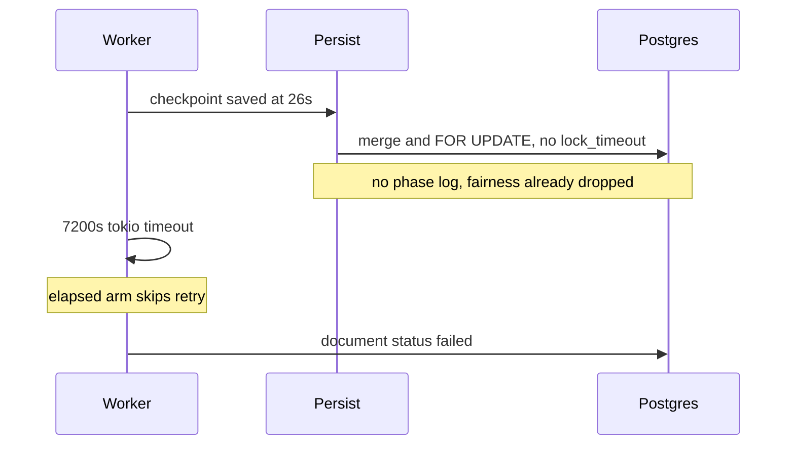

# 00 — WHY

Parent: [README](README.md) · Next: [01 First principles](01-first-principles.md)

## The problem in one sentence

A document can sit in processing for two hours after all useful work has finished, and a restart can make every worker fail `claim_next` on a pool that is already closed.

Both happened on 2026-10-21. The PPD stall is [incident A](02-incident-catalogue.md). The prod pool errors are [incident B](02-incident-catalogue.md). The code that still does this is [03-code-facts](03-code-facts.md).

## Five WHYs

**WHY-171-1 — Why did the document stay in processing for two hours?**
Extraction, embeddings, and the resume checkpoint finished in 26 s. The next step, graph persist, is awaited with no deadline of its own. The only clock is the worker wall clock, 7200 s. Postgres was not asked to cancel the session: ingest sessions set `idle_in_transaction_session_timeout` and do not set `lock_timeout`, `statement_timeout`, or `transaction_timeout`. A session waiting on a lock is `active`, so the idle-in-transaction timer does not fire.

```text
┌────────────────────────────────────────────────────────────┐
│ 06:56:07  prepare                                          │
│ 06:56:32  extract + embed                                  │
│ 06:56:33  checkpoint saved          last line from the task│
│ 06:56:33  persist starts            no log, no deadline    │
│ 08:56:07  worker timeout            7200 s, permanent      │
└────────────────────────────────────────────────────────────┘
```

ROOT → [LAW-171-1](01-first-principles.md). The timeout stack is [04](04-postgres-theory.md).

**WHY-171-2 — Why was the timeout permanent when a checkpoint had just been written?**
`tokio::time::timeout` returns `Err(_elapsed)` on the wall clock. That arm calls `mark_failed` and `on_permanent_failure`. It does not read `can_retry()`, `max_retries`, or `is_permanent_ingestion_failure`. The `Ok(Err(e))` arm above it does. The checkpoint load on the next attempt already exists. It is never reached.

The message `Task processing timed out after 7200 seconds` is not a typed timeout (`Operation timed out` or `[ingestion_failure_class=Timeout`). `mark_failed` therefore increments `retry_count` and resets `consecutive_timeout_failures`. The log line `retry_count: 1` is that increment. No retry ran.

ROOT → [LAW-171-2](01-first-principles.md), [LAW-171-4](01-first-principles.md).

**WHY-171-3 — Why can two documents in one workspace block each other for that long?**
The fairness permit is dropped before persist, so several documents in one workspace merge at once. CVs share entity rows (`FRANCE`, `PYTHON`, `MACHINE_LEARNING`). The merger upserts those rows. The committer takes `SELECT … FOR UPDATE` on the document, its revision, and its bindings. Nothing serializes the merge per workspace. There is no `lock_timeout`, so a waiter sits until the outer 7200 s clock.

A solo re-upload of the same PDF completed. The file is not the cause.

ROOT → [LAW-171-3](01-first-principles.md). Lock scope is [05](05-architecture.md). Shared-row theory is [04](04-postgres-theory.md).

**WHY-171-4 — Why could operators not see where it stalled?**
Between the checkpoint line and `P-G2 persist completed` the persist function does not log phase lines with top-level `document_id` and `task_id`. `task_id` on pipeline lines lives in the `task_process` span. The timeout text does not name the progress stage. Nothing snapshots `pg_stat_activity` at the moment the clock fires, so the lock graph is gone.

ROOT → [LAW-171-4](01-first-principles.md).

**WHY-171-5 — Why did prod workers fail to claim on a closed pool?**
`Server::run` closes the pools at the end of HTTP drain, then returns. `main` shuts the worker pool down only after `server.run()` returns. For that whole window the pools are closed and the workers are still in the `'worker` loop. `claim_next` returns `attempted to acquire a connection on a closed pool`. The error arm sleeps one second and `break`s the inner claim attempt, not the `'worker` loop, so the next poll tries again and logs another error. The fairness sweep does the same acquire against the same closed pool.

```text
┌──────────────┐    ┌──────────────┐    ┌──────────────────┐
│ SIGTERM      │ -> │ close pools  │ -> │ workers still    │
│ HTTP drain   │    │ Pool::close  │    │ claim_next       │
└──────────────┘    └──────────────┘    └──────────────────┘
                                                 │          
                                                 v          
                                        keeps logging errors
```

ROOT → [LAW-171-5](01-first-principles.md).

## Product statement

A stuck persist must fail in minutes, name the stage, release its backend, and retry from the checkpoint while retries remain. A shutdown must stop workers before it closes pools. Raising the 7200 s clock only lengthens the silence.


