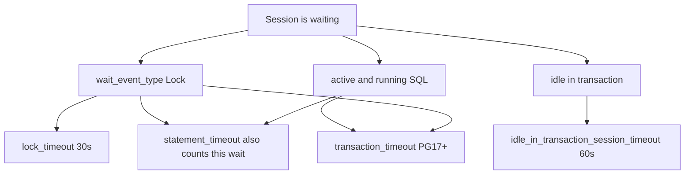

# 04 — Postgres theory

Parent: [README](README.md) · Prev: [03 Code facts](03-code-facts.md) · Next: [05 Architecture](05-architecture.md)

Product images are PostgreSQL 16, 17, and 18 ([version matrix](../../docs/data-layer/version-matrix.md)). The pages below are the PostgreSQL 18 manuals, which are `current` as of October 2026. Behavior cited for 16 and 17 is called out. This page is the theory behind [LAW-171-1](01-first-principles.md) and [LAW-171-3](01-first-principles.md).

## Which timer covers which wait

PostgreSQL does not have one "query timeout". Each GUC covers a different wait. Setting them in `postgresql.conf` is the wrong layer: they would hit every session, including migrations and interactive reads. They belong on the ingest session, or as `SET LOCAL` inside the write transaction ([SET](https://www.postgresql.org/docs/current/sql-set.html)).

| GUC | What it aborts | What it does not abort | Since |
|-----|----------------|------------------------|-------|
| `lock_timeout` | This lock-acquisition attempt (table, row, advisory) | A statement that is running and not waiting for a lock | 9.3 |
| `statement_timeout` | One statement, from arrival to completion, including its lock wait | The sum of many short statements | longstanding |
| `idle_in_transaction_session_timeout` | A session idle inside an open transaction | An `active` session, including one in `wait_event_type = Lock` | 9.6 |
| `transaction_timeout` | Any transaction that lives longer than the limit, idle or active | Prepared transactions. Absent on PostgreSQL 16 | 17 |
| `idle_session_timeout` | A session idle with no transaction | Ingest work | 14 |

Source: [19.11 Client Connection Defaults](https://www.postgresql.org/docs/current/runtime-config-client.html). `transaction_timeout` shipped in [PostgreSQL 17](https://www.postgresql.org/docs/17/release-17.html).

The manual states two rules the implementation must not violate:

1. `lock_timeout` only fires while waiting for a lock. If `statement_timeout` is set to the same or a smaller value, `lock_timeout` never wins, because the statement timer already expired. Keep `lock_timeout` strictly shorter. Default 30 s against a persist budget of minutes. See [EC-171-02](06-edge-cases.md).
2. If `transaction_timeout` is shorter than or equal to `statement_timeout` or `idle_in_transaction_session_timeout`, the longer of those is ignored. On PostgreSQL 17 and 18, set `transaction_timeout` strictly above `statement_timeout`, and above the 60 s idle-in-transaction setting. See [EC-171-01](06-edge-cases.md).

```text
┌────────────────────────────────────────────────────────────┐
│ session edgequake:ingest                                   │
│                                                            │
│   lock_timeout            30 s     lock wait only          │
│   statement_timeout       budget-1 s   one statement       │
│   transaction_timeout     budget   PG 17+ whole transaction│
│   idle_in_transaction     60 s     idle open txn only      │
│                                                            │
│   Rust persist deadline   budget   outer bound, loses race │
│   worker wall clock       >= 7200 s    not the persist cap │
└────────────────────────────────────────────────────────────┘
```



Incident A sat in the lock-wait or the running-SQL cell. The only timer that was set, idle-in-transaction, covers a different cell. That is [F-171-08](03-code-facts.md).

## Server cancel before the client gives up

`tokio::time::timeout` drops the Rust future. sqlx does not guarantee a PostgreSQL cancel request on that drop. The backend keeps the lock and the pool slot (GH-336, written in `statement_timeout.rs`). [LAW-171-1](01-first-principles.md) is the fix:

- `lock_timeout` turns a lock wait into `55P03` (`lock_not_available`) while the client is still awaiting the statement.
- `statement_timeout` turns a runaway statement into `57014` (`query_canceled`).
- On PostgreSQL 17+, `transaction_timeout` bounds the sum of short statements inside one transaction. PostgreSQL 16 does not have it ([EC-171-01](06-edge-cases.md)). On 16 the Rust deadline is the sum, and the in-flight statement still carries `statement_timeout` so the current statement dies. The deadline handler also drops that connection instead of returning it to the pool while the backend is alive.
- Headroom is the existing 250 ms pattern: the server limit is shorter than the Rust limit for the same scope, so the error the client observes is a SQLSTATE, not a silent elapsed timer.

Codes: [Appendix A](https://www.postgresql.org/docs/current/errcodes-appendix.html). `55P03`, `40P01` (`deadlock_detected`), and `57014` are the transient set in [LAW-171-2](01-first-principles.md). `40P01` already arrives within `deadlock_timeout` (default 1 s). It must be classified transient, not as `GraphMerge`.

`SET LOCAL` dies at `COMMIT` or `ROLLBACK` and cannot leak into the next checkout ([SET](https://www.postgresql.org/docs/current/sql-set.html)). Session-level `lock_timeout` on `edgequake:ingest` is still required, because some upserts autocommit. `after_release` runs `RESET ALL` and must re-pin the new GUC, or the next checkout has `lock_timeout = 0` (disabled). See [EC-171-03](06-edge-cases.md).

A value of `0` disables each of these timers. Ingest must not treat `0` as "use the default" by accident, and must not accept it as an operator opt-out on this path. A bad literal is rejected by the one helper ([LAW-171-6](01-first-principles.md), [EC-171-20](06-edge-cases.md), [EC-171-39](06-edge-cases.md)).

## Row locks on shared entity keys

`INSERT … ON CONFLICT DO UPDATE` takes a row lock on the existing tuple. CVs in one workspace share keys (`FRANCE`, `PYTHON`, `MACHINE_LEARNING`). Two merges that update the same row queue on that tuple lock. `FOR UPDATE` on the document row in the committer queues the same way for a re-upload of the same document ([explicit locking](https://www.postgresql.org/docs/current/explicit-locking.html)).

Without `lock_timeout` the waiter is `active` until the holder commits, rolls back, or the client process dies. A holder that is itself waiting on a pool slot, or on a client that has abandoned the future, holds the row until the backend is cancelled. That is how 26 s of work becomes 7200 s of silence ([WHY-171-1](00-why.md), H-A1 and H-A2 in [02](02-incident-catalogue.md)).

Heap-only updates (HOT) keep that lock on the same tuple when the indexed key does not change. They do not remove the lock. Serialization has to come from a lock that both writers take in the same order, before they touch entity rows.

## One advisory lock, transaction scoped

Session advisory locks (`pg_advisory_lock`) are held until unlock or disconnect. The community refresh path uses that and keeps the `PgConnection` in a map. Copying it for merge would pin a pool slot across the summary LLM and make H-A2 worse ([F-171-12](03-code-facts.md)).

`pg_advisory_xact_lock(key1, key2)` is released at transaction end, including rollback ([advisory-lock functions](https://www.postgresql.org/docs/current/functions-admin.html#FUNCTIONS-ADVISORY-LOCKS)). It is visible to every API replica. It does not take a table lock, so readers of other workspaces are unaffected.

`hashtext` returns a 32-bit int. A single key collides across unrelated strings often enough to matter at fleet scale. The two-argument form already used for `edgequake.community` is the one merge uses:

```sql
SELECT pg_advisory_xact_lock(
    hashtext('edgequake.merge'),
    hashtext($1)  -- workspace id
);
```

Take it after `SET LOCAL lock_timeout`, before the upserts, inside the same transaction. A 30 s wait then returns `55P03` instead of sitting until 7200 s. Two workspaces hash to different second keys except for the residual `hashtext` collision, which [EC-171-04](06-edge-cases.md) accepts as the same residual the community lock already has. Do not invent a third key style.

The lock covers the write. It does not cover extraction, embedding, or the summary HTTP call ([EC-171-05](06-edge-cases.md)). Holding it across that call would serialize LLM latency and pin the transaction open, which blocks vacuum on the rows it touched ([idle-in-transaction and bloat](https://www.postgresql.org/docs/current/routine-vacuuming.html)).

## Pool arithmetic

A pool of size N deadlocks itself if a task holds one connection and waits for a second. Postgres does not record that wait. Incident A’s persist path acquires inside the merger, the committer, and the typed-embedding pool while an outer connection may still be checked out (H-A2).

The rule for the write transaction: one connection for the transaction that holds the advisory lock and the upserts. Do not acquire a second connection before that transaction commits. LLM calls happen with zero ingest connections checked out. See [EC-171-06](06-edge-cases.md).

`Pool::close` rejects new acquires at once and waits for connections already out ([Pool::close](https://docs.rs/sqlx/latest/sqlx/struct.Pool.html#method.close)). Closing before workers stop turns every `claim_next` into the error in incident B, and a stuck checked-out connection makes `close` itself block. Drain first ([LAW-171-5](01-first-principles.md)).

## What this page refuses

- Raising `shared_buffers`, `work_mem`, or the worker wall clock to hide a missing `lock_timeout`
- `statement_timeout` in `postgresql.conf`
- `pg_advisory_lock` held for the whole merge, including the LLM
- Assuming PostgreSQL 16 has `transaction_timeout`
