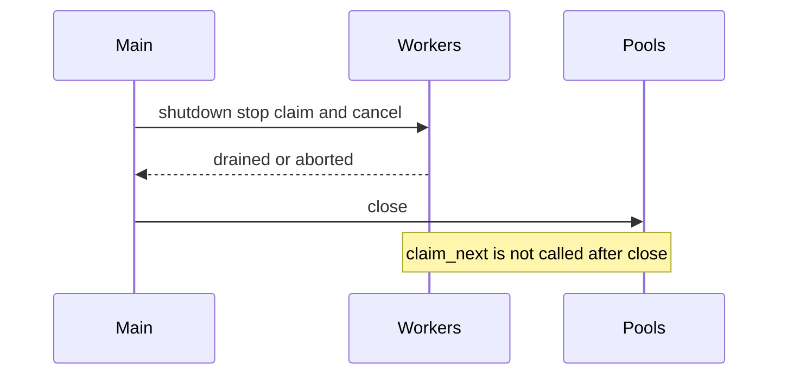

# 05 — Architecture

Parent: [README](README.md) · Prev: [04 Postgres theory](04-postgres-theory.md) · Next: [06 Edge cases](06-edge-cases.md)

Target shape for [LAW-171-1](01-first-principles.md) through [LAW-171-6](01-first-principles.md). Waves are [07](07-implementation-plan.md). This page names owners. It does not paste a second copy of the SQL helpers.

## Persist, after the change

```text
┌──────────────────────────────────────────────────────────────┐
│ extract + embed, concurrent, no lock                         │
└──────────────────────────────────────────────────────────────┘
                                │                               
                                v                               
┌──────────────────────────────────────────────────────────────┐
│ checkpoint saved                                             │
└──────────────────────────────────────────────────────────────┘
                                │                               
                                v                               
┌──────────────────────────────────────────────────────────────┐
│ persist deadline B                                           │
└───────────────────────────────┬──────────────────────────────┘
                                │                               
              └─────────────────┴───────────────┘               
              v                                 v               
┌────────────────────────────┐    ┌────────────────────────────┐
│ fast path                  │    │ slow path                  │
│ one transaction            │    │ read, then LLM             │
│ advisory xact lock         │    │ write if unchanged         │
└────────────────────────────┘    └────────────────────────────┘
```

Fairness stays dropped before this diagram ([F-171-03](03-code-facts.md)). The advisory lock is what stops two documents in one workspace from interleaving upserts. Other tenants keep claiming.

## Budgets

| Knob | Default | Clamp | Owner |
|------|---------|-------|-------|
| `EDGEQUAKE_PERSIST_TIMEOUT_SECS` | 900 | `30 .. effective_task_timeout - 60` | persist deadline module |
| `EDGEQUAKE_DB_INGEST_LOCK_TIMEOUT_SECS` | 30 | `1 .. 120`, and strictly under the statement budget | session baseline for `edgequake:ingest` |
| `TASK_PROCESSING_TIMEOUT_SECS` | 7200 floor | unchanged | worker. Not a persist cap |
| Idle in transaction | 60 s | unchanged | already in the baseline |
| Activity snapshot | 5 s | fixed | snapshot function |

`effective_task_timeout` is the duration the worker actually waits (metadata override or config), not `WorkerPoolConfig::processing_timeout_secs` alone ([F-171-15](03-code-facts.md)).

On a large PDF the persist budget scales with `LargeDocumentProfile` the same way `ingest_timeout_secs` grows with pages, then the clamp above still forces it under the task timeout. A 2-chunk CV stays at 900 s. A document whose real persist exceeds 900 s is [EC-171-16](06-edge-cases.md), not a reason to delete the inner deadline.

Server side, for a budget `B` seconds:

| Server | PostgreSQL 16 | PostgreSQL 17 and 18 |
|--------|---------------|----------------------|
| `lock_timeout` | 30 s | 30 s |
| `statement_timeout` | `B - 1` s | `B - 1` s |
| `transaction_timeout` | not set | `B` s |

`B - 1` keeps `transaction_timeout` strictly greater than `statement_timeout`, so PostgreSQL does not ignore the statement timer ([04](04-postgres-theory.md)). The Rust deadline is `B`. The server wins by at least one second, plus the existing 250 ms headroom on any `SET LOCAL` that mirrors a shorter inner call.

Version detection happens once per connection in `after_connect`, from `server_version_num`. PostgreSQL 16 must not receive `SET transaction_timeout` ([EC-171-01](06-edge-cases.md)).

## Who owns what

| Concern | Owner | Callers |
|---------|-------|---------|
| Timeout literal check | `statement_timeout.rs` (promoted) | baseline, committer, merger transaction, migrate runner, vector DDL |
| Ingest session GUCs | `apply_session_baseline` | pool `after_connect` and `after_release` |
| `SET LOCAL` inside the write transaction | one function next to `LocalTimeoutTx` | committer and the merge write transaction |
| Workspace merge lock | one function, two-key `pg_advisory_xact_lock` | the write transaction only |
| Failure class | `IngestionFailureClass::PersistContention` in `ingestion_reliability.rs` | worker retry arm, persist `TaskError` |
| Phase log fields | one helper used by persist phases | generation, chunk vectors, merger, committer, fleet vectors |
| Activity snapshot | one function, 5 s `statement_timeout` | timeout arm, best effort |
| Shutdown order | `main` after workers drain | `close_db_pools` moves to after `worker_pool.shutdown` |

The worker does not import sqlx. It sees a `TaskError` whose text the classifier already understands ([DIP](01-first-principles.md)).

## Write transaction

Fast path, the incident CV:

1. No ingest connection is held.
2. Begin a transaction on one connection.
3. `SET LOCAL lock_timeout` and `SET LOCAL statement_timeout` through the helper.
4. `pg_advisory_xact_lock(hashtext('edgequake.merge'), hashtext(workspace_id))`.
5. Upsert entity rows and relationship rows (`ON CONFLICT`).
6. Commit. The advisory lock dies with the transaction.
7. Committer transaction, same pattern, `FOR UPDATE` after its own `SET LOCAL`.

Slow path, 8 or more fragments or past 1200 tokens:

1. Short transaction: lock, read the current description and a version (the row’s `xmin`, or a hash the merger already stores), commit.
2. LLM call with zero connections held.
3. Write transaction: lock, re-read. If the version matches, write the summary. If it does not, merge again in memory. One extra LLM call is allowed. A third is a transient `PersistContention`, not a silent overwrite.

That is the optimistic check in [LAW-171-3](01-first-principles.md). It is the way to keep a single writer without pinning a connection across HTTP.

## Error path

A transient failure returns `TaskError` from persist. It does not pass through `storage_errors` and `Ok`. Finalize does not mark the document `failed` on that path. The document stays in `indexing` until the retry finishes or the budget is spent.

The worker elapsed arm calls the same function as the `Ok(Err)` arm:

- transient, retries left, breaker closed → `requeue_for_retry` and the existing backoff
- otherwise → `permanent_failure_reason` and `on_permanent_failure`

The message prefix is stable: `persist deadline exceeded`. The classifier matches that prefix, `55P03`, `40P01`, and `57014` before the `GraphMerge` substrings. Checkpoint load on the next attempt is the existing extraction path. No second checkpoint.

`mark_failed` runs once. The elapsed arm must not increment `retry_count` and then call a second fail transition.

## Shutdown order

```text
┌────────────┐   ┌─────────────────┐   ┌──────────────┐   ┌────────────┐
│ SIGTERM    │-->│ stop workers    │-->│ close pools  │-->│ drop ingest│
│            │   │ cancel in flight│   │ Pool::close  │   │ runtime    │
└────────────┘   └─────────────────┘   └──────────────┘   └────────────┘
```

Today the middle two steps are reversed ([F-171-13](03-code-facts.md)). `Server::run` stops closing pools itself. `main` closes them after `worker_pool.shutdown()`.

`PoolClosed` (`attempted to acquire a connection on a closed pool`) breaks the `'worker` loop and is logged once at `warn`. The fairness sweep returns when it sees the same error. In-flight work cancelled by shutdown is requeued or left lease-reclaimable. It is not left `processing` with a live lease and a dead process. See [EC-171-14](06-edge-cases.md) and [EC-171-21](06-edge-cases.md).



## Logs

One `info` at the start of each persist phase, fields `document_id` and `task_id` at the top level (not only inside `task_process`):

- `persist.phase = generation | chunk_vectors | merger | committer | fleet_vectors`

On the deadline, the message is:

`persist deadline exceeded after {secs}s in stage {stage} (attempt {n} of {max})`

When the worker wall clock fires for a non-persist stall, the same shape is used with the effective seconds, not `config.processing_timeout_secs`.

The snapshot query is the one in [02](02-incident-catalogue.md), plus `pg_blocking_pids`, limited to `edgequake:%`, `left(query, 120)`, its own 5 s `statement_timeout`. It logs pid, wait event, xact age, and the truncated query. It does not log bind values.

## Non-goals repeated

No schema change. No AGE revival. No in-process mutex in production. No second timeout helper. No change to the query-path `LocalTimeoutTx` budgets.
