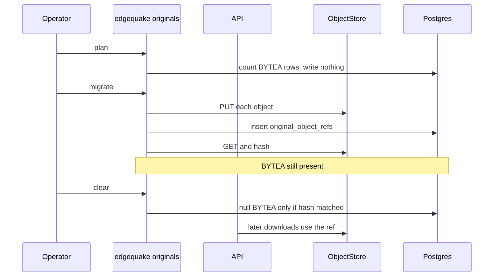

# 00 — WHY

Parent: [README](README.md) · Next: [01 First principles](01-first-principles.md)

## The problem in one sentence

Original uploaded files live in Postgres `BYTEA`, so every backup, WAL stream, and restore carries file bytes that the query engine does not search.

The code that does this is [02-code-facts](02-code-facts.md). The laws are [01](01-first-principles.md).

## Five WHYs

**WHY-172-1 — Why do original documents sit in the database?**
Upload and download were built against Postgres. PDF bytes are `pdf_document_blobs.pdf_data`. Non-PDF bytes are `document_originals.original_data`. SPEC-090 (migration 105) moved PDF bytes off the `pdf_documents` row so list queries would stop toasting them, and left the bytes in Postgres. There is no object-store crate in the workspace.

```text
┌────────────────────────────────────────────────────────────┐
│ POST upload                                                │
└────────────────────────────┬───────────────────────────────┘
                             │                                
              ┌──────────────┴──────────────┐                 
              v                             v                 
┌──────────────────────────┐  ┌──────────────────────────────┐
│ PDF                      │  │ image, text file, other      │
│ pdf_document_blobs       │  │ document_originals           │
│ pdf_data BYTEA           │  │ original_data BYTEA          │
└──────────────────────────┘  └──────────────────────────────┘
```

ROOT → [LAW-172-1](01-first-principles.md).

**WHY-172-2 — Why is that the wrong place for the bytes?**
A `BYTEA` value is a row. Large values are TOASTed, and TOAST still rides in WAL and in base backups ([TOAST](https://www.postgresql.org/docs/current/storage-toast.html)). The list path already refuses to detoast `documents.content` because a `LEFT` or `LENGTH` holds a pool slot ([F-172-10](02-code-facts.md)). PDF range reads use `substring(bytea …)`, which is correct and still pulls the window through the database connection. The retrieval product is the text, the chunks, and the graph. The original file is a blob.

ROOT → [LAW-172-1](01-first-principles.md), [LAW-172-3](01-first-principles.md).

**WHY-172-3 — Why a config mode, not a forced cutover?**
Existing installs boot with `DATABASE_URL` and no bucket. A release that requires S3 would fail closed for every current operator. `EDGEQUAKE_ORIGINAL_STORE=database` keeps today's writes. `object` is chosen per deployment, and every replica must agree ([LAW-172-7](01-first-principles.md)). The HTTP routes stay, so the viewer does not learn a new URL.

ROOT → [LAW-172-7](01-first-principles.md), [LAW-172-5](01-first-principles.md).

**WHY-172-4 — Why one crate for S3, GCS, Azure, and MinIO?**
Those four systems do not share a wire protocol. AWS S3, Google Cloud Storage, and Azure Blob Storage each have their own API. MinIO speaks the S3 API and, unless `MINIO_DOMAIN` is set, expects path-style requests. A second or third SDK would fork put, range, and delete. The Apache `object_store` crate already maps `s3://`, `gs://`, and `az://` / `abfs://` onto one `ObjectStore` trait ([03](03-object-store-theory.md)).

ROOT → [LAW-172-2](01-first-principles.md), [LAW-172-6](01-first-principles.md), [LAW-172-8](01-first-principles.md).

**WHY-172-5 — Why an independent migration tool?**
History is already in `BYTEA`. A request handler must not rewrite that history: the upload path is for new bytes, and a failed request must not clear a file the user can still download. The move is copy, verify SHA-256, then clear, and clear is a separate command. The database bytes stay until verify passes. The tool runs as `edgequake originals` without the HTTP server, and it calls the same put and verify functions the server uses.

```text
┌──────────────┐    ┌──────────────┐    ┌──────────────┐    ┌──────────────┐
│ plan         │ -> │ copy         │ -> │ verify       │ -> │ clear        │
│ read-only    │    │ PUT + ref    │    │ SHA-256      │    │ BYTEA null   │
│ default      │    │ BYTEA kept   │    │ mismatch stop│    │ explicit     │
└──────────────┘    └──────────────┘    └──────────────┘    └──────────────┘
```

ROOT → [LAW-172-4](01-first-principles.md), [LAW-172-6](01-first-principles.md).

## Product statement

An operator turns on object storage with one config value, keeps search and the viewer working, and moves existing originals with a command that refuses to delete database bytes until the bucket copy matches. New uploads in object mode never write `BYTEA`.


