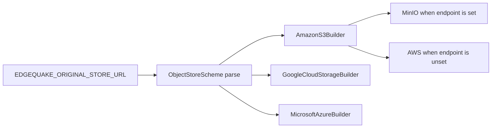

# 03 — Object store theory

Parent: [README](README.md) · Prev: [02 Code facts](02-code-facts.md) · Next: [04 Architecture](04-architecture.md)

Facts in this file were checked on **2026-10-23**. Each row names the page. W1 re-reads the pinned crate version on docs.rs and probes the Chainguard image. If a fact moved, this file is corrected before code merges. Unprobed items are marked.

## One trait, three URL schemes

The Apache `object_store` crate is the client ([crate overview](https://docs.rs/object_store/latest/object_store/)). Feature flags select backends:

| Feature | Builder | URL scheme the crate recognises |
|---------|---------|----------------------------------|
| `aws` | `AmazonS3Builder` | `s3://bucket/path` and `s3a://` |
| `gcp` | `GoogleCloudStorageBuilder` | `gs://bucket/path` |
| `azure` | `MicrosoftAzureBuilder` | `az://` and `abfs://` / `abfss://` (`container[@account.host]/path`) |

`ObjectStoreScheme::parse` documents those mappings ([parse.rs](https://docs.rs/object_store/latest/src/object_store/parse.rs.html)). `memory://` and `file://` exist for tests. Production EdgeQuake does not use `file://` as the original store: a local disk path is not S3, GCS, or Azure, and it splits backup strategy. Tests may use `InMemory`.

Multipart writes use `ObjectStore::put_multipart` and `WriteMultipart` (same crate page). A 50 MiB object ([F-172-08](02-code-facts.md)) fits in one `put`. The implementation still calls the multipart helper when the crate's part threshold says so, so a future cap change does not fork the write path. Checksum-on-multipart had a historical bug ([arrow-rs-object-store#34](https://github.com/apache/arrow-rs-object-store/issues/34), closed 2025). This design does not send `with_checksum_algorithm` as the source of truth. EdgeQuake hashes locally.

```text
┌──────────────┐   put / get_opts(range) / delete   ┌──────────────┐
│ EdgeQuake    │ ----------------------------------> │ ObjectStore  │
│ one module   │                                     │ trait        │
└──────────────┘                                     └──────┬───────┘
                                                            │
                     ┌──────────────┬──────────────┬────────┴───────┐
                     v              v              v                v
              ┌────────────┐ ┌────────────┐ ┌────────────┐ ┌────────────┐
              │ S3         │ │ MinIO      │ │ GCS        │ │ Azure Blob │
              │ aws feature│ │ same aws   │ │ gcp        │ │ azure      │
              │ path style │ │ path style │ │ gs://      │ │ az://      │
              └────────────┘ └────────────┘ └────────────┘ └────────────┘
```



## S3 and path style

`AmazonS3Builder::with_virtual_hosted_style_request` ([docs.rs](https://docs.rs/object_store/latest/object_store/aws/struct.AmazonS3Builder.html)):

- `false` (crate default): path-style, `https://endpoint/bucket/key`
- `true`: virtual-hosted, and the endpoint must already include the bucket name

`with_endpoint` defaults to the regional AWS endpoint. A custom endpoint such as `http://localhost:9000` needs `with_allow_http(true)`. Without it the client returns `URL scheme is not allowed` ([arrow-rs#5273](https://github.com/apache/arrow-rs/issues/5273)).

Path-style is what MinIO serves unless a domain is configured. EdgeQuake uses path-style when `EDGEQUAKE_ORIGINAL_STORE_ENDPOINT` is set. Real AWS, with no custom endpoint, uses virtual-hosted style. AWS documents both and says path-style will be discontinued; the September 2020 cutoff was delayed and is not a date you can code against ([Virtual hosting](https://docs.aws.amazon.com/AmazonS3/latest/userguide/VirtualHosting.html), [AWS blog](https://aws.amazon.com/blogs/aws/amazon-s3-path-deprecation-plan-the-rest-of-the-story/)). A bucket name that contains a dot breaks the virtual-hosted wildcard certificate. Those buckets set `EDGEQUAKE_ORIGINAL_STORE_PATH_STYLE=true` on purpose.

`with_checksum_algorithm` exists. This spec stores EdgeQuake's SHA-256 on `original_object_refs`. The S3 ETag is optional metadata. For a multipart upload the ETag is not an MD5 of the object ([Object](https://docs.aws.amazon.com/AmazonS3/latest/API/API_Object.html)). [LAW-172-4](01-first-principles.md) forbids treating ETag as the checksum.

Conditional `If-None-Match: *` is an AWS feature. It is not required, and it is not assumed on MinIO. Idempotency is "same key, same bytes, success".

SSE is off unless `EDGEQUAKE_OBJECT_STORE_SSE` is set. Allowed values in this spec: unset, or `AES256`. A KMS key id is a later spec. The bucket's own default encryption still applies. EdgeQuake does not turn it off.

## Google Cloud Storage

Bucket names and object names are the GCS model ([buckets](https://cloud.google.com/storage/docs/buckets)). The crate URL is `gs://bucket/prefix`. Credentials follow the builder: a service-account JSON, or Application Default Credentials on GCE or GKE. EdgeQuake does not invent a second credential file format.

Uniform bucket-level access is the GCP posture this spec expects, so object ACLs cannot override a private bucket. The spec requires a private bucket. It does not create the bucket.

## Azure Blob Storage

The Azure equivalent of an S3 bucket is a container in a storage account ([Introduction to Blob storage](https://learn.microsoft.com/en-us/azure/storage/blobs/storage-blobs-introduction)). The crate accepts `az://container/path` and `abfs://` / `abfss://`. Account name and key, or a workload identity, come from the builder's environment. A connection string is accepted only as the builder already parses it. It is never logged.

## MinIO via Chainguard

Two dates, two facts:

1. **2025-10-23.** MinIO stopped publishing the community Docker image. Chainguard documents the replacement ([Secure and Free MinIO Chainguard Containers](https://www.chainguard.dev/unchained/secure-and-free-minio-chainguard-containers), 2025-10-27) and the run recipe ([Getting started](https://edu.chainguard.dev/chainguard/containers/getting-started/web-and-data-services/minio/)).
2. **2026-02-12.** The `minio/minio` GitHub repository was marked unmaintained ([commit history](https://github.com/minio/minio/commits), README note "THIS REPOSITORY IS NO LONGER MAINTAINED"). The community edition remains source-only under AGPL-3.0.

Supported image:

```yaml
services:
  minio:
    image: cgr.dev/chainguard/minio:latest
    ports:
      - "9000:9000"
      - "9001:9001"
    environment:
      MINIO_ROOT_USER: minioadmin
      MINIO_ROOT_PASSWORD: minioadmin123
    command: server /data --console-address ":9001"
    volumes:
      - minio-data:/data
volumes:
  minio-data:
```

API `http://localhost:9000`. Console `http://localhost:9001`. Those ports and the command match the Academy compose checked on 2026-10-23.

Path-style is MinIO's default. `MINIO_DOMAIN` turns on virtual-host buckets ([MinIO config README](https://github.com/minio/minio/blob/master/docs/config/README.md), environment-only `MINIO_DOMAIN`). EdgeQuake compose does not set `MINIO_DOMAIN`. The SDK sets the endpoint, the credentials, path-style, and allow-http for this local URL.

**Healthcheck and user, not yet probed.** The Academy compose runs `curl -f http://localhost:9000/minio/health/live`. The published image user is 65532 ([specifications](https://images.chainguard.dev/directory/image/minio/specifications)). Distroless images have no `curl` and no shell, so that healthcheck fails inside the container ([the same break in other ports](https://github.com/Altinity/clickhouse-backup/issues/1394)). A named volume inherits 65532 on first create. A bind mount owned by root does not ([Langfuse #11090](https://github.com/langfuse/langfuse/issues/11090)). W1 records whether `curl` exists. The design does not use an in-container curl check either way. Readiness is EdgeQuake `/ready`. Bucket creation is a one-shot `cgr.dev/chainguard/minio-client`, because this image has no `mc`. Single-node MinIO reports parity 0. That compose service is a development store.

Dev credentials in the compose snippet are for local only. Helm and production values do not use `minioadmin`.

## Postgres facts the move depends on

Large `BYTEA` is TOASTed and still logged and backed up ([TOAST](https://www.postgresql.org/docs/current/storage-toast.html)). `UPDATE` to NULL marks the toast dead. Space returns to the operating system on `VACUUM FULL`, or a rewrite tool such as `pg_repack`, not on ordinary autovacuum ([VACUUM](https://www.postgresql.org/docs/current/sql-vacuum.html)). The CLI must say this ([EC-172-17](05-edge-cases.md)).

`SELECT … FOR UPDATE SKIP LOCKED` is how two migrator processes avoid the same row ([SELECT](https://www.postgresql.org/docs/current/sql-select.html)). The maintenance role has `BYPASSRLS`. The BYTEA read stays inside the claim transaction, with `statement_timeout` raised for that transaction only. The PUT happens after `COMMIT`. Holding a row lock across a network PUT would stall uploads.

The reaper does not list the bucket. `ListObjectsV2` returns at most 1,000 keys and must be paged ([ListObjectsV2](https://docs.aws.amazon.com/AmazonS3/latest/API/API_ListObjectsV2.html)). A partial page is not a license to delete everything else. S3 `GET` after a successful `PUT` is strongly consistent ([S3 consistency](https://aws.amazon.com/s3/consistency/)), which is why verify can read immediately. Delete on a versioned bucket writes a delete marker ([versioning](https://docs.aws.amazon.com/AmazonS3/latest/userguide/Versioning.html)). Postgres PITR and the bucket are one recovery set.

## What W1 still has to measure

| Item | Status on 2026-10-23 |
|------|----------------------|
| Crate version pin | **0.14.2** (`object_store`, features `aws`, `gcp`, `azure`). `AmazonS3Builder::with_virtual_hosted_style_request` still means path-style when false. `with_allow_http` is still required for an `http://` endpoint. Re-read on 2026-10-23 from docs.rs 0.14.2 |
| `cgr.dev/chainguard/minio:latest` has `curl` | Probed 2026-10-23. `Config.User` is `65532`. Entrypoint is `/usr/bin/minio`. `docker run --entrypoint /usr/bin/curl` fails: `stat /usr/bin/curl: no such file or directory`. Compose does not use an in-container curl check. |
| MinIO `If-None-Match` | Not relied on |
| GCS and Azure live credentials | Not required for merge. Same trait, config-only. MinIO e2e is the mandatory gate |
