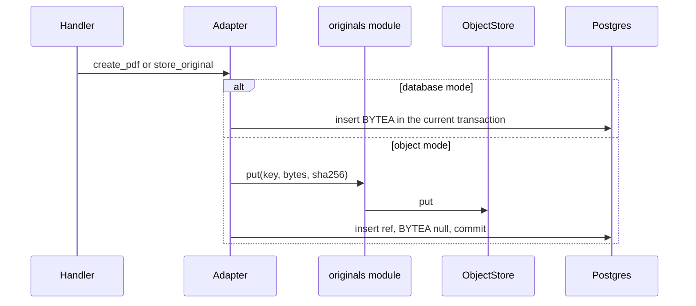
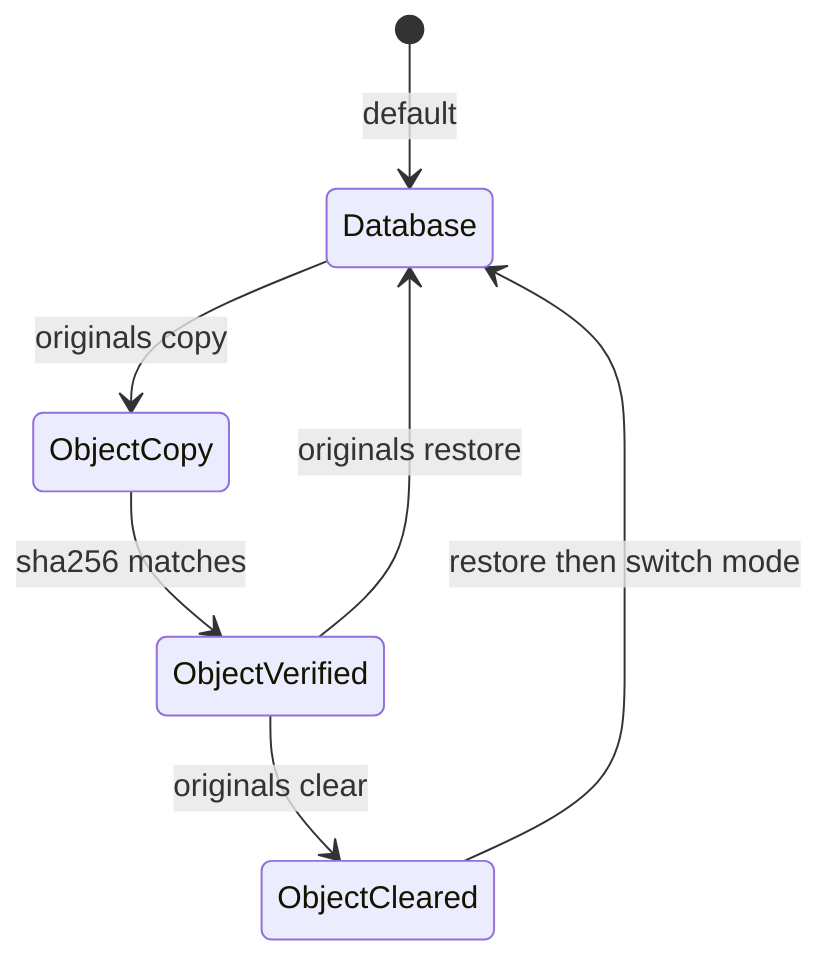

# 04 — Architecture

Parent: [README](README.md) · Prev: [03 Object store theory](03-object-store-theory.md) · Next: [05 Edge cases](05-edge-cases.md)

## Modules

```text
┌─────────────────────────────────────────────────────────────┐
│ HTTP handlers                                               │
│ content.rs range stream    download.rs original            │
│ traits only, no S3 types                                    │
└─────────────┬───────────────────────────────┬───────────────┘
              │                               │
              v                               v
┌──────────────────────────┐    ┌────────────────────────────┐
│ PdfDocumentStorage       │    │ DocumentOriginalStorage    │
│ create / range / delete  │    │ store / get / delete       │
└─────────────┬────────────┘    └─────────────┬──────────────┘
              │                               │
              v                               v
┌─────────────────────────────────────────────────────────────┐
│ edgequake-storage::originals                                │
│ key(), put(), get_range(), verify_sha256(), delete()       │
│ Arc dyn ObjectStore                                         │
└─────────────┬───────────────────────────────┬───────────────┘
              │                               │
              v                               v
┌──────────────────────────┐    ┌────────────────────────────┐
│ Postgres                 │    │ Bucket                     │
│ original_object_refs     │    │ s3 gs az                   │
│ nullable BYTEA           │    │ private                    │
└──────────────────────────┘    └────────────────────────────┘
              ^
              │
┌─────────────┴───────────────────────────────────────────────┐
│ edgequake originals                                         │
│ plan copy verify clear status restore                       │
│ same originals module, no HTTP                              │
└─────────────────────────────────────────────────────────────┘
```

New code lives in `edgequake/crates/edgequake-storage/src/originals/` (config, key, store wrapper, reaper) and `edgequake/src/originals_cmd.rs` (CLI). Adapters in `pdf_storage_impl.rs` and `original_storage_impl.rs` gain a branch. They do not gain a second public trait.



## Config

| Variable | Required | Meaning |
|----------|----------|---------|
| `EDGEQUAKE_ORIGINAL_STORE` | no | `database` (default) or `object` |
| `EDGEQUAKE_ORIGINAL_STORE_URL` | when `object` | `s3://bucket/prefix`, `gs://bucket/prefix`, or `az://container/prefix` |
| `EDGEQUAKE_ORIGINAL_STORE_ENDPOINT` | MinIO and other non-AWS S3 | `http://localhost:9000` |
| `EDGEQUAKE_ORIGINAL_STORE_REGION` | S3 | `us-east-1` is fine for MinIO |
| `EDGEQUAKE_ORIGINAL_STORE_ACCESS_KEY_ID` | S3 static keys | also accepts `AWS_ACCESS_KEY_ID` if the EdgeQuake variable is unset |
| `EDGEQUAKE_ORIGINAL_STORE_SECRET_ACCESS_KEY` | S3 static keys | never logged |
| `EDGEQUAKE_ORIGINAL_STORE_PATH_STYLE` | no | unset: path-style when `ENDPOINT` is set, virtual-hosted when it is not. `true` / `false` force one style |
| `EDGEQUAKE_ORIGINAL_STORE_ALLOW_HTTP` | no | default `false`; local MinIO sets `true` |
| `EDGEQUAKE_ORIGINAL_STORE_CREATE_BUCKET` | no | default `false`. `true` is legal only when `ENDPOINT` is set (local MinIO). Production clouds do not auto-create |
| `EDGEQUAKE_OBJECT_STORE_SSE` | no | unset or `AES256` |
| GCS | when URL is `gs://` | `GOOGLE_APPLICATION_CREDENTIALS` or ADC, as the crate already reads |
| Azure | when URL is `az://` or `abfs://` | account plus key, or the crate's workload identity |

`database` ignores the URL. A URL set with `database` is a warning at boot, not a connection.

`edgequake originals` uses a role with `BYPASSRLS` (suggested name `edgequake_originals_maint`). The API role stays without that attribute. Give the maintenance role `SELECT`, `UPDATE` on the two BYTEA tables and `INSERT`, `UPDATE`, `DELETE` on the ref and queue tables. Do not grant it to the application user.

## Pointer table (migration 215)

```text
original_object_refs
  pdf_id          uuid      null, FK pdf_documents(pdf_id) ON DELETE CASCADE
  document_id     uuid      null, FK documents(id) ON DELETE CASCADE
  tenant_id       uuid      not null
  workspace_id    uuid      not null
  object_key      text      not null, unique
  sha256          char(64)  lowercase hex
  byte_length     bigint    not null
  content_type    text      not null
  etag            text      null
  verified_at     timestamptz null until verify
  created_at      timestamptz
  CHECK (num_nonnulls(pdf_id, document_id) = 1)
  UNIQUE (pdf_id) WHERE pdf_id IS NOT NULL
  UNIQUE (document_id) WHERE document_id IS NOT NULL
```

One `owner_id` is not used. A foreign key has one parent ([foreign keys](https://www.postgresql.org/docs/current/ddl-constraints.html)).

`pdf_document_blobs` and `document_originals` gain `byte_location text not null default 'database'` with `check (byte_location in ('database','object'))`. The `BYTEA` columns become nullable. The check is on the same row only ([constraints](https://www.postgresql.org/docs/current/ddl-constraints.html)):

- `byte_location = 'database'` implies the `BYTEA` is not null
- `byte_location = 'object'` implies the `BYTEA` is null

Copy may set `byte_location` to `database` while a ref already exists. That is the dual-copy state. Clear sets `byte_location = 'object'` and the `BYTEA` to null only where `verified_at` is set. A cross-table `CHECK` is not part of migration 215.

RLS matches migration 167's workspace list: forced RLS, restrictive policy, tenant checked through `workspaces`.

`pdf_documents.sha256_checksum` stays the dedup key ([F-172-15](02-code-facts.md)). The ref stores the same hex. Non-PDF rows gain their first checksum on the ref, computed while copying.

Supporting tables, same migration:

- `original_object_inflight(object_key primary key, created_at)` — committed before PUT, deleted in the metadata commit
- `original_object_deletes(object_key primary key, enqueued_at)` — filled by a `BEFORE DELETE` trigger on `original_object_refs`, so workspace wipe and raw SQL take the same path as `delete_pdf`

## Keys

```text
{prefix}/t/{tenant_uuid}/w/{workspace_uuid}/pdf/{pdf_uuid}
{prefix}/t/{tenant_uuid}/w/{workspace_uuid}/original/{document_uuid}
```

`prefix` is the path component of the store URL, or empty. UUIDs are hyphenated lowercase. The filename is not part of the key ([LAW-172-8](01-first-principles.md)).

## Write, delete, reaper

```text
upload object mode
  1. hash SHA-256
  2. dedup PDF by existing checksum in the workspace
  3. BEGIN; INSERT inflight; COMMIT
  4. PUT key
  5. BEGIN
  6. INSERT metadata, byte_location = object, BYTEA null
  7. INSERT ref verified_at = now(); DELETE inflight
  8. COMMIT
  on 23505: DELETE the new object and the inflight row, return Conflict
  on crash after 4: inflight row remains; reaper deletes that key after 1 hour

delete (any path, including workspace wipe)
  1. DELETE parent row
  2. BEFORE DELETE on original_object_refs inserts original_object_deletes
  3. CASCADE removes the ref
  4. COMMIT
  5. delete object; DELETE the queue row
  on failure at 5: queue row remains; reaper retries

reaper
  SELECT inflight where created_at < now() - interval '1 hour'
  DELETE those objects, then the inflight rows
  SELECT original_object_deletes and retry
  zero ListObjects calls
```

The one-hour bound is the crash window. The reaper does not delete an inflight row younger than one hour.

Copy in the migrator does not use the inflight table for rows that already have `BYTEA`. It claims with `SKIP LOCKED`:

```text
BEGIN
  SET LOCAL statement_timeout = '120s'
  SELECT blob FOR UPDATE SKIP LOCKED
  where byte_location = 'database' and ref is null
  limit 1
  -- read BYTEA on the BYPASSRLS maintenance role, still inside the transaction
COMMIT
PUT
BEGIN
  INSERT ref
COMMIT
```

`get_pdf` when `byte_location = 'object'` loads bytes through `originals::io` into `PdfDocument.pdf_data`. `fetch_pdf_row` does not `SELECT` a null `BYTEA` into `Vec<u8>`. Range reads go through `inclusive_to_get_range` so `start..=end` becomes a half-open `GetRange`.

Two CLI processes can run. They will not PUT the same owner. A server in `object` mode does not insert `BYTEA`, so new uploads are outside this claim.

## Health

`HealthResponse` gains:

- `original_store`: `database` or `object`
- `components.original_store_ready`: `true` in database mode; in object mode, `true` only after a bucket head or list at boot

`/health` stays 200 when the bucket is down and the process is up. `/ready` is 503 when mode is `object` and the bucket was unreachable. `storage_mode` is unchanged ([F-172-16](02-code-facts.md)). `HealthResponse` is `ToSchema`. The OpenAPI snapshot is regenerated in the same wave as the new fields.

## SOLID map

| Principle | Owner |
|-----------|--------|
| SRP | `originals::config` parses env. `originals::key` builds keys. `originals::io` puts and gets. `originals_cmd` prints UX. Adapters decide BYTEA versus pointer. |
| OCP | A new cloud is a new URL scheme in config. No new trait method. |
| LSP | Both modes return `Vec<u8>` ranges. |
| ISP | Handlers never see `AmazonS3Builder`. |
| DIP | The store handle is `Arc<dyn ObjectStore>` plus the key helper. Tests pass `InMemory`. |
| DRY | CLI copy calls `originals::io::put` and `originals::io::verify`. Upload calls the same functions. |

## Boot rules

```text
┌────────────────────┐     ┌────────────────────┐
│ mode = database    │     │ mode = object      │
│ refs table empty   │     │ bucket reachable   │
│ serve as today     │     │ serve from refs    │
└────────────────────┘     └────────────────────┘
         │                            │
         v                            v
┌────────────────────┐     ┌────────────────────┐
│ refs exist         │     │ bucket down        │
│ exit at boot       │     │ /health 200        │
│ name the mode      │     │ /ready 503         │
└────────────────────┘     └────────────────────┘
```



Switching to `database` after clear, without `restore`, is a boot failure ([LAW-172-7](01-first-principles.md)): the bytes are no longer in Postgres.
