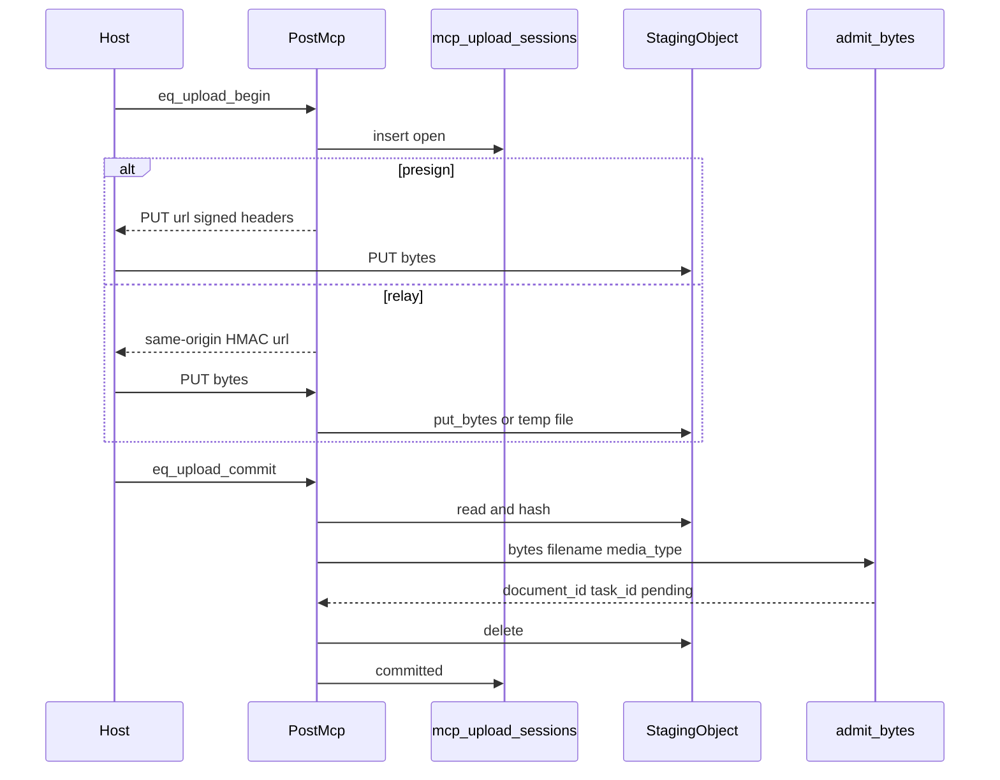

# 04 — Architecture

Parent: [README](README.md) · Prev: [03 Protocol](03-protocol.md) · Next: [05 Contract delta](05-contract-delta.md)

## Where the bytes go

```text
┌──────────────────────────────────────────────────────────────┐
│ MCP host (Cursor, Claude, Codex, ChatGPT)                   │
│ model sees upload_id                                         │
│ host PUTs raw bytes                                          │
└───────────────┬────────────────────────────┬─────────────────┘
                │ presign                    │ relay
                v                            v
┌───────────────────────────┐  ┌────────────────────────────────┐
│ private bucket            │  │ PUT /api/v1/mcp/uploads/{id}   │
│ staging key .../upload/   │  │ HMAC, and bearer if asked      │
└───────────────┬───────────┘  └───────────────┬────────────────┘
                │                              │
                └──────────────┬───────────────┘
                               v
┌──────────────────────────────────────────────────────────────┐
│ eq_upload_commit                                             │
│ length + sha256                                              │
│ admit_bytes  (existing PDF or document path)                │
│ delete staging                                               │
└───────────────┬──────────────────────────────────────────────┘
                v
┌──────────────────────────────────────────────────────────────┐
│ Postgres                                                     │
│ mcp_upload_sessions                                          │
│ documents, tasks, and the SPEC-172 canonical object          │
└──────────────────────────────────────────────────────────────┘
```



## Modules, and why they stay split

One reason to change belongs in one module. Callers depend on the small trait, not on S3 types.

| Module | Owns | Does not own |
|--------|------|----------------|
| `originals/key.rs` | `OwnerKind::Upload` and the staging key string | HTTP, HMAC, MCP JSON |
| `originals/presign.rs` (new) | `signed_url_opts` with `Method::PUT` and the signed headers | Choosing database vs object, admitting a document |
| `originals/io.rs` | `put_bytes`, get, delete of a key | MCP tool names |
| Session repository in `edgequake-storage` | Insert, lock, mark committed, list expired staging keys | Verifying a bearer |
| `mcp/project/upload_session.rs` | Map tool arguments to the row and to `admit_bytes` | SigV4, SQL text |
| `handlers/mcp_upload_relay.rs` (new) | HMAC check, optional bearer, stream the body | `admit_bytes` (commit does that) |
| `mcp/gateway/tools.rs` | JSON Schema and descriptions | Transfer choice |
| `mcp/src/gateway-bridge.ts` | Forward `tools/call`. Later, a local-path helper | Minting URLs |

Dependency direction stays `edgequake-api` → `edgequake-storage`. The storage crate does not reference MCP types.

The transfer choice is one function, `select_transfer(store_mode, signer_result, bind_mode) -> Presign | Relay`. Begin calls it once. Commit does not re-decide. It reads `transfer` off the row.

## Staging versus the canonical object

```text
  staging key                         canonical key
  .../upload/{uuid}                   .../pdf/{pdf_id}
                                      .../original/{document_id}

  written by the host PUT             written by the existing
  or by relay put_bytes               SPEC-172 path inside admit

  deleted on commit, abort,           referenced by
  or reaper                           original_object_refs
```

Commit in object mode reads the staging object and passes the bytes to `admit_bytes`. That function's existing object-mode branch writes the canonical key and the ref row. The staging key is then deleted. Two writes of at most 50 MiB are the cost of not forking admission. [LAW-173-6](01-first-principles.md) accepts that cost.

Database mode never opens a bucket. Relay writes the temp file. Commit reads it and `admit_bytes` stores `BYTEA`, as today.

## Reaper

The reaper selects `staging_key` from `mcp_upload_sessions` where status is `aborted` or `expired`, or status is `committed` and `staging_key` is still set, and `expires_at` is in the past. It deletes those keys and nulls the column. It does not call `ListObjects`. A truncated list would be able to see keys this table does not own. SPEC-172 [LAW-172-3](../172-object-store/01-first-principles.md) uses the same rule for its own queue. The upload reaper is a second query, not a copy of that queue, because staging rows are not `original_object_inflight`.

## Auth on the two doors

```text
  tools/call eq_upload_*
       |
       +-- profile query  --> existing "tool requires control profile"
       +-- missing edgequake:write --> existing insufficient_scope
       +-- tenant and workspace on the row
       +-- user_id when both sides have one

  PUT /api/v1/mcp/uploads/{id}
       |
       +-- HMAC over the declared hash, type, length, expiry
       +-- bearer, only when the row says bind=bearer
       +-- no List, no GET, no key in the path the client picks
```

The relay route is mounted next to the other `/api/v1` routes. It is not behind `DefaultBodyLimit` of 1 MiB. Its limit is the row's `byte_length`, which begin already capped at `max_document_size`. A body larger than that is rejected before it is stored.

## What the Web UI does

Nothing in this spec. The browser keeps posting to the document and PDF routes. Those routes already call the same admission functions. [Front lens](lenses/LENS-front.md).
