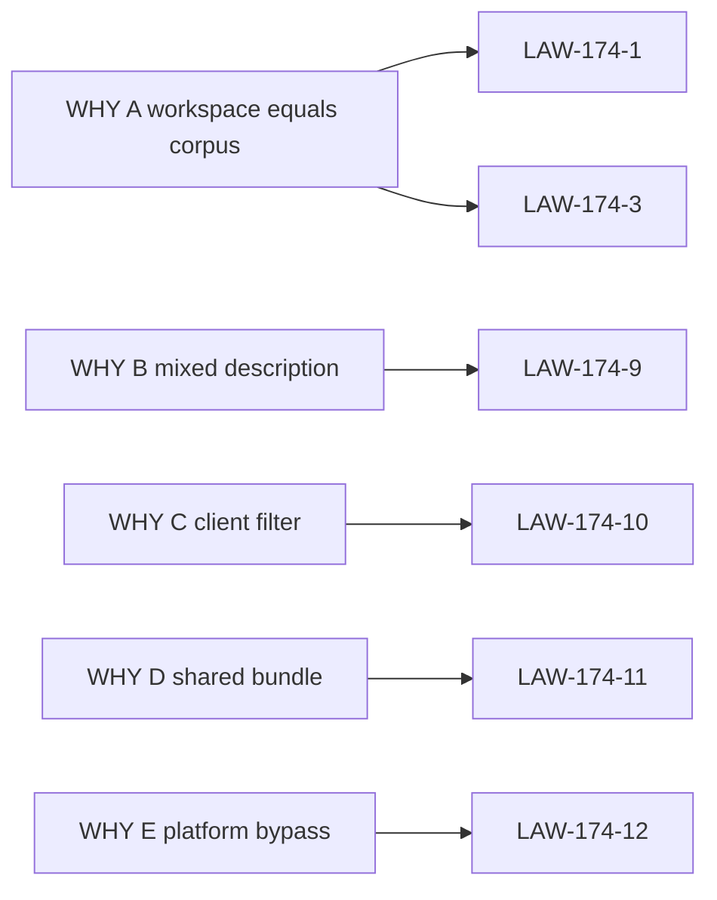

# 15 — Cross-reference

Parent: [README](README.md) · Prev: [14-e2e-test-matrix](14-e2e-test-matrix.md) ·
Next: [16-performance](16-performance.md)

## WHY to law

| WHY | Laws |
|-----|------|
| A workspace = corpus | LAW-174-1, LAW-174-3, LAW-174-6 |
| B mixed description | LAW-174-9, LAW-174-16 |
| C client filter | LAW-174-5, LAW-174-10 |
| D shared bundle | LAW-174-11 |
| E platform bypass | LAW-174-8, LAW-174-12 |

## Law to finding, case, wave, test, lens

| Law | Finding | ECs | Wave | Primary test | Lens |
|-----|---------|-----|------|--------------|------|
| LAW-174-1 | F-174-01 | 31, 32 | W4, W9 | `e2e_spec174_readonly_clearance` | Full stack, Product |
| LAW-174-2 | F-174-13 | 35 | W2 | `e2e_spec174_enforcement_off` | Product |
| LAW-174-3 | F-174-01, F-174-13 | 01, 02 | W3, W4 | `e2e_spec174_no_security_role` | Security |
| LAW-174-4 | F-174-02, F-174-06 | 12, 13, 33 | W4, W10 | `e2e_spec174_hidden_id_404` | Security, Database |
| LAW-174-5 | F-174-03 | 14, 15 | W3, W5 | `e2e_spec174_empty_filter_is_visible_set` | Full stack |
| LAW-174-6 | F-174-02, F-174-14 | 12, 33, 34, 40 | W2, W4, W10 | `e2e_spec174_no_kv_on_deny` | Database |
| LAW-174-7 | F-174-10 | 09, 11 | W4 | `e2e_spec174_tag_delete_restrict` | Security, Documents |
| LAW-174-8 | F-174-10, F-174-11 | 17–22, 28, 39 | W6, W7, W10 | `e2e_spec174_dedup_no_oracle` | Security, Documents |
| LAW-174-9 | F-174-04, F-174-05 | 16, 17, 18, 42 | W6 | `e2e_spec174_legacy_description` | Graph |
| LAW-174-10 | F-174-03, F-174-12 | 14, 15 | W5, W9 | `e2e_spec174_filter_intersection` | Full stack, AI |
| LAW-174-11 | F-174-07, F-174-08 | 10, 23–27 | W7 | `e2e_spec174_retrieval_id` | AI, Security |
| LAW-174-12 | F-174-09 | 30 | W3 | `e2e_spec174_admin_master_key` | Security |
| LAW-174-13 | F-174-06 | 01, 09 | W4 | `e2e_spec174_uploader_after_raise` | Documents |
| LAW-174-14 | F-174-13 | 08, 41 | W4, W8 | `e2e_spec174_enable_flag_last` | Product, UX |
| LAW-174-15 | all | 01–39 | W10 | [14-e2e-test-matrix](14-e2e-test-matrix.md) | Full stack |
| LAW-174-16 | F-174-04, F-174-12 | 16, 38 | W5, W6, W7 | `e2e_spec174_glossary` | AI, Graph |

Algebra cases EC-174-03, EC-174-04, EC-174-05 are unit tests in W1. They
sit under LAW-174-3 and the decision in [05-policy-model](05-policy-model.md).
EC-174-06 also has an e2e query in W5. EC-174-36 is LAW-174-6 plus the
existing workspace key, wave W10, `e2e_spec174_cross_workspace`.

## Prior specs

| Prior | What SPEC-174 inherits | What it does not change |
|-------|------------------------|-------------------------|
| [SPEC-154](../154-sec-hardening/) | Session, audience, cookies | Clearance is not a new token store |
| [SPEC-158](../158-entreprise-grade-authentication/) | Tenant bind. The broken SPEC-146 link is this pack | SSO and JIT |
| [SPEC-169](../169-perfect-user-management/) | Membership roles and the members screen | The four membership roles |
| [SPEC-164](../164-pure-postgres-study/) | Plain `eq_graph_nodes` / `eq_graph_edges` | AGE is not revived |
| [SPEC-103](../103-llm-cache/) | Answer and keyword caches | Answer key stays a prompt hash |
| [SPEC-126](../126-provider-kv-cache/) | Provider prefix cache | Prefixes that include retrieved text gain a fingerprint |
| [SPEC-005](../005-filter.md) / [SPEC-031](../031-filter-document/000-overview.md) | `document_filter` JSON and `allowed_document_ids` | Empty filter stops meaning all-pass when enforcement is on |
| [SPEC-152](../152-new-mcp-contract/08-security-observability.md) | MCP scopes `read` / `query` / `write` | Scopes do not become labels |
| [SPEC-001](../001-benchmark/) | Acc score | Flag stays off |
| Migration 167 / 206 / 208 | Tenant RLS, leakproof columns, InitPlan | Clearance is a second restrictive policy |

## Code symbols

| Symbol | Path | Finding |
|--------|------|---------|
| `require_request_permission` | `edgequake-api/src/services/request_authorization.rs` | F-174-01 |
| `Role`, `Permission` | `edgequake-auth/src/types.rs`, `rbac.rs` | F-174-01 |
| `tenant_access_guard` | `migrations/167_tenant_access_rls.sql` | F-174-02 |
| `set_tenant_context` | `edgequake-storage/.../postgres/rls.rs` | F-174-02 |
| `resolve_document_filter` | `handlers/query/document_filter_resolver.rs` | F-174-03 |
| Description merge | `edgequake-pipeline/src/merger/entity.rs` | F-174-04 |
| `filter_context_by_document_ids` | `edgequake-query/src/context_filter.rs` | F-174-04 |
| `pg_bfs_expand` | `edgequake-storage/.../graph/query_ops/expand.rs` | F-174-05 |
| `download_document_markdown` | `handlers/documents/query/download.rs` | F-174-06 |
| `shell_value_by_key` | `edgequake-storage/.../document_shell.rs` | F-174-06 |
| `cache_key` | `edgequake-query/src/cache/query_result_cache.rs` | F-174-07 |
| `global_retrieval_cache` | `edgequake-api/src/services/retrieval_id_cache.rs` | F-174-07 |
| `llm_cache_storage_key` | `edgequake-query/src/cache/llm_response_cache.rs` | F-174-08 |
| Master-key skip | `bind_request` in `request_authorization.rs` | F-174-09 |
| `resolve_workspace_duplicate_for_reingestion` | `services/document_reingest.rs` | F-174-10 |
| `relational_workspace_doc_ids` | `services/workspace_document_index.rs` | F-174-13 |
| Chunk ANN document predicate | chunk embedding index, `document_id = ANY` | F-174-14 |

## Document map

| Doc | Role |
|-----|------|
| [README](README.md) | Entry, locked decisions, job diagram |
| [00-why](00-why.md) | Five causes |
| [01-first-principles](01-first-principles.md) | LAW-174-1…16 |
| [02-surfaces](02-surfaces.md) | Where the code is |
| [03-product-spec](03-product-spec.md) | Stories and acceptance |
| [04-findings](04-findings.md) | F-174-01…14 |
| [05-policy-model](05-policy-model.md) | Algebra and citations |
| [06-graph-query-ai](06-graph-query-ai.md) | Projection and prompts |
| [07-data-and-db-contract](07-data-and-db-contract.md) | Migration 220 |
| [08-api-contract](08-api-contract.md) | Routes and 404 |
| [09-ux-ui-spec](09-ux-ui-spec.md) | Screens |
| [10-frontend-architecture](10-frontend-architecture.md) | One client module |
| [11-threat-model](11-threat-model.md) | Abuse cases |
| [12-edge-cases](12-edge-cases.md) | EC-174-01…39 |
| [13-implementation-plan](13-implementation-plan.md) | W0–W11 |
| [14-e2e-test-matrix](14-e2e-test-matrix.md) | One gate per EC |
| [16-performance](16-performance.md) | Indexes and EXPLAIN |
| [17-roadblocks](17-roadblocks.md) | Code gaps and the mitigations |
| [lenses/](lenses/) | Nine reviews of the same laws |

Next: [16-performance](16-performance.md).
