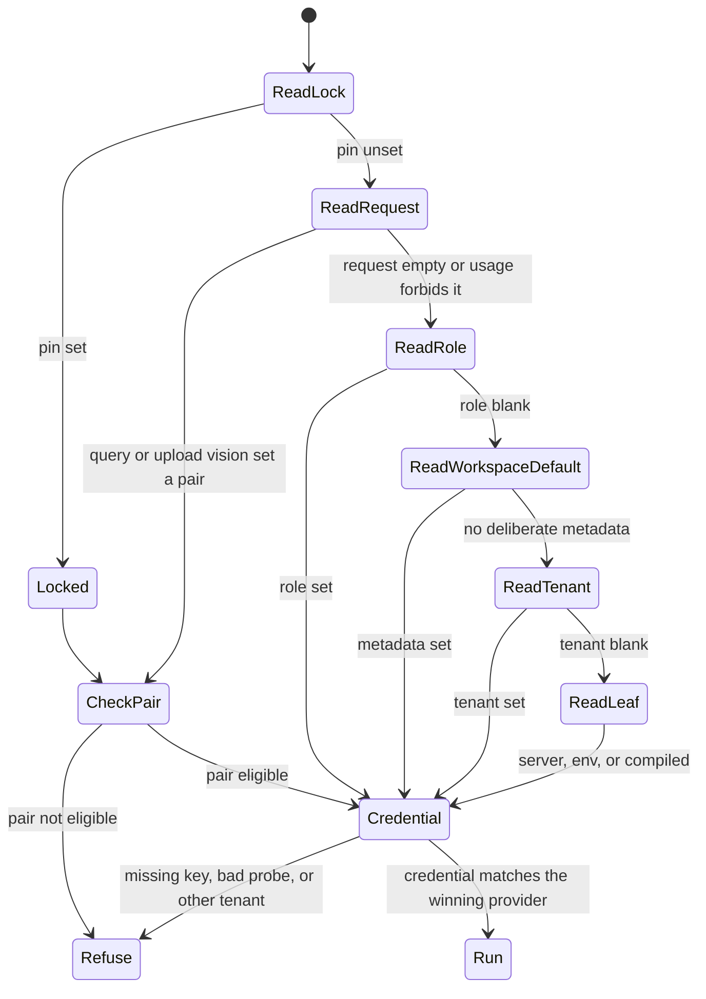

# 05 — Resolution law

Parent: [README](README.md) · Prev: [04-findings](04-findings.md) ·
Next: [06-catalog](06-catalog.md)

This file is the contract for `resolve_usage`. [LAW-175-1](01-first-principles.md)
and [LAW-175-2](01-first-principles.md) point here. Call sites stop
keeping a private order.

## Function

```text
  resolve_usage(usage, ctx) -> ResolvedUsage

  ctx:
    request_provider, request_model, request_effort   (optional)
    workspace                                         (optional)
    tenant                                            (optional)
    server_defaults                                   (llm_defaults JSON)
    priority_mode                                     (server | env)
    locks                                             (from env pins)
    policy                                            (ceiling + narrowing)
    catalog                                           (capabilities)
    probe                                             (connection last_test_ok)
```

`ResolvedUsage`:

| Field | Meaning |
|-------|---------|
| `usage` | the enum |
| `provider` | provider id |
| `model` | model id |
| `connection_id` | set when the winning layer named one |
| `reasoning_effort` | post-clamp, may be absent |
| `source` | winning layer |
| `locked` | true when source is `operator_lock` |
| `eligible` | false when policy or capability rejects the pair |
| `broken_reason` | `none`, `not_eligible`, `capability`, `credential`, `probe`, `cross_tenant` |

The function does not build an HTTP client. The API layer loads the
connection and constructs the provider from `connection_id` + `model`.
If `broken_reason != none`, the API does not construct a client.

## Order

```text
  1 operator_lock     pin env for this usage, if set
  2 request           query, or vlm when the upload set both fields
  3 workspace_role    llm_roles.{usage} when any field is non-empty
  4 workspace_default deliberate metadata for that family
  5 tenant_default    tenant default_* for that family
  6 server_config     server_config.llm_defaults
  7 env_bootstrap     EDGEQUAKE_LLM_*, EDGEQUAKE_EMBEDDING_*, vision env
  8 compiled_default  models.toml [defaults], one table
```

Step 2 runs only for `query` and `vlm`. For other usages the request
fields are ignored, not rejected, so an old client that echoes them does
not break extract. [EC-175-54](11-edge-cases.md). A query or upload that sets an ineligible pair is
`broken_reason = not_eligible` and does not fall through. Falling through
would hide the user's choice. [LAW-175-4](01-first-principles.md).

`EDGEQUAKE_CONFIG_PRIORITY=env` swaps steps 6 and 7. It does not move
steps 1–5. [EC-175-13](11-edge-cases.md).

## What "sets a value" means

A layer wins when provider or model is non-empty. The other field is
filled from the next layer that has it, same as `fill_missing_provider_model`
today. Provenance stays on the layer that supplied the first non-empty
field. This keeps LAW-123 behavior for partial pairs.

Workspace LLM and embedding count only when metadata has the deliberate
key (`workspace_has_llm_override`, LAW-123-8). Painted struct fields
without those keys are not a workspace choice. Vision keeps the same
rule under this pack: Option fields that were inherit-painted do not
count. Today `workspace_has_vision_override` also treats Option fields as
deliberate ([`model_resolution.rs:212`](../../edgequake/crates/edgequake-core/src/model_resolution.rs)).
W1 aligns vision with LAW-123-8. That is a behavior fix, called out in
[EC-175-22](11-edge-cases.md).

## Family defaults

| Usage | Workspace default keys | Tenant default keys |
|-------|------------------------|---------------------|
| extract, query, summary, keyword | `llm_provider`, `llm_model` | `default_llm_*` |
| vlm | `vision_llm_*`, else the LLM default | `default_vision_llm_*`, else tenant LLM |
| embedding | `embedding_*` | `default_embedding_*` |
| decision | `decision_model` | none (env leaf) |
| rerank | none | none (env leaf only) |

Role-specific `llm_roles.{usage}` beats the family default. Keyword with
no role and no lock uses the resolved query usage (today's "else the
answer LLM"), and the source is recorded as `workspace_default` or
whatever layer supplied the query model. It is not a hidden sixth chain.

## Operator locks

Built by the same match as `env_role_llm` today
([`llm_roles.rs:357`](../../edgequake/crates/edgequake-core/src/llm_roles.rs)):
provider only, model only, or both. Provider only still fills the model
from the small compiled map (mistral / openai / ollama). That map moves
into the catalog's compiled default for the provider so it is not a
private table inside `env_role_llm`. [F-175-17](04-findings.md).

Manuscript lock applies only when the page modality is manuscript-class,
as `resolve_vision_provider_for_modality` does today. Other pages use the
normal vlm ladder. The effective endpoint reports the lock on the
manuscript branch, not as the workspace default.

While a lock is set:

- `locked = true`
- picker disabled
- role `connection_id` is not used
- the lock's provider must still pass credential and capability checks
- a lock that fails the probe is `broken_reason = probe`, not a silent
  workspace fallback

## Reasoning effort

Effort is not a model. `resolve_usage` calls the existing
`resolve_role_reasoning_effort` and stores the result on `ResolvedUsage`.
Order stays SPEC-109, with one correction: the tenant argument is passed
from the workspace's tenant. Today the query handler passes `None`
([F-175-02](04-findings.md) notes the gap). Clamp stays in
`edgequake_llm::clamp_reasoning_effort`. `EDGEQUAKE_LLM_OMIT_REASONING_EFFORT`
and `EDGEQUAKE_LLM_OMIT_TEMPERATURE` stay transport flags. They are not
layers and not settings rows. [EC-175-14](11-edge-cases.md).

## Fail closed

After the ladder picks a pair:

```text
  pair eligible for usage?
       | no -> broken_reason = capability or not_eligible
       | yes
  connection in this tenant or fleet?
       | no -> cross_tenant
       | yes
  probe ok, or no probe yet and env key present?
       | no -> probe or credential
       | yes
  run
```

`try_create_llm_provider` returning `None` and
`execute_sota_query_with_auth_fallback` are deleted as success paths.
The handler maps `broken_reason` to [08-api-contract](08-api-contract.md).

Startup `state.query.llm_provider` remains the client for the
`env_bootstrap` and `compiled_default` layers when those layers win and
the process key is the credential. It is not a recovery path when a
higher layer failed.

## Decision and rerank

`decision` enters `resolve_usage` so the effective endpoint can show it.
The backend kind stays env-only (`ollama_system_one`). `openai_logprobs`
is still refused at boot. Workspace may set `decision_model`,
`decision_pack_size`, `decision_gate_preset`, and `decision_enabled`
inside the existing SPEC-160 gate. Those fields are not chat models.

`rerank` resolves to the process reranker or to "not configured". There
is no workspace row in W1–W6. A request `rerank_model` is 422
`rerank_model_rejected`.

## State machine



## Acc

SPEC-001 sets extract and often keyword pins. Under this law those pins
are step 1. No policy rows are required. The doctor output may print
`source=operator_lock`. Scores do not depend on a workspace metadata
key. [EC-175-02](11-edge-cases.md).
