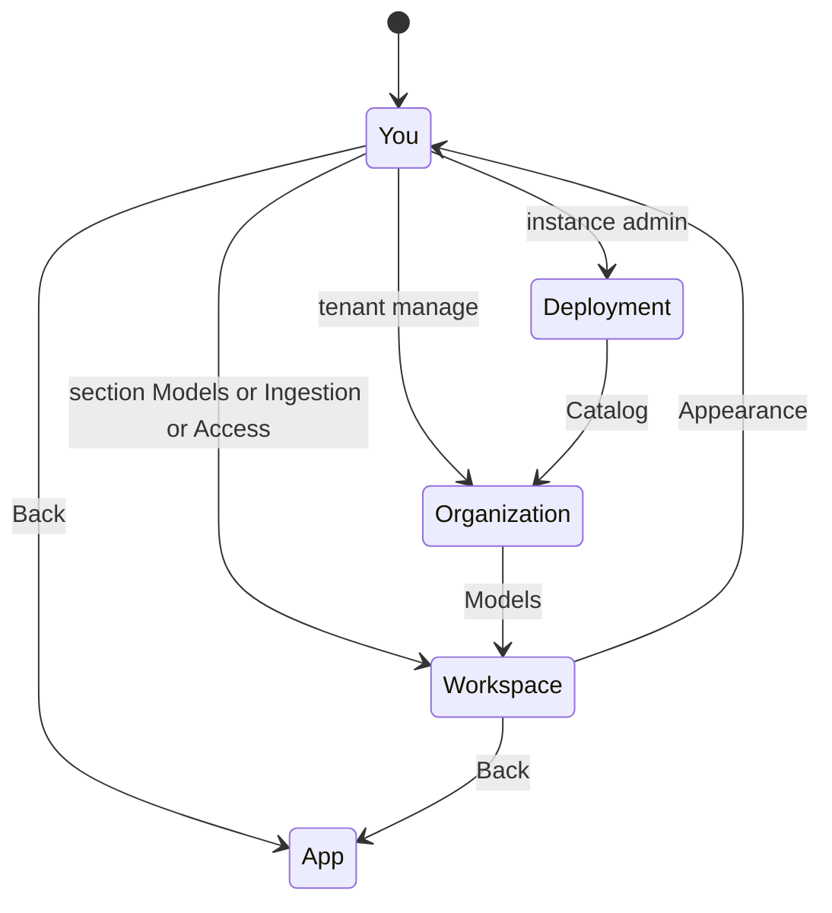

# 09 — UX and UI spec

Parent: [README](README.md) · Prev: [08-api-contract](08-api-contract.md) ·
Next: [10-frontend-architecture](10-frontend-architecture.md)

[LAW-175-8](01-first-principles.md) · [LAW-175-16](01-first-principles.md).
Words in the wireframes are the copy in [03-product-spec](03-product-spec.md).
A designer may change spacing. They may not add a second place that writes
the same model.

## References

| Product | What we take | What we leave |
|---------|--------------|---------------|
| [Vercel / GitHub](https://github.com/onetimesecret/onetimesecret/issues/2307) | Account, team, and project are different owners, labeled in the chrome | Vercel's billing screens |
| [Linear](https://brainy.ink/paper/the-settings-page-problem) | Search first, groups in a sidebar, a way back to the app | A single mixed "settings" bucket |
| Notion | Query, graph, and upload settings stay next to that work | A central page that also edits them |
| [K2View](https://support.k2view.com/Academy/articles/04_fabric_studio/studio_ai/06_ai_configuration_and_settings.html) | Discover models, then choose which appear in the picker | Per-model request JSON on the same screen |
| [BYOK](https://byok.pro/blog/design-model-reasoning-controls/) | The capability map decides which controls render | Temperature on every usage |

## Coverage

Every row in [02-surfaces](02-surfaces.md) is in this table. A wire id means
this file draws it. "Removed" means the control leaves the product.
"Unchanged" means another spec already draws the inner fields.

| Today | Wire | Disposition |
|-------|------|-------------|
| Theme, language | [W-03](#w-03-you-appearance) | One writer shared with the header |
| Graph labels, size, layout | [W-04](#w-04-you-graph-display) | Same store as the canvas |
| Query mode, stream | [W-24](#query-chip), [W-25](#w-25-query-sheet) | Stay next to query. Not on You |
| Rerank, rerank top K | — | Removed. [LAW-175-7](01-first-principles.md) |
| Gleaning, max passes, summarization toggle | — | Removed |
| Server LLM defaults | [W-22](#w-22-fleet-defaults-and-health) | Deployment |
| Two provider status cards | [W-22](#w-22-fleet-defaults-and-health) | One health list |
| Effective-config panel | [W-06](#w-06-workspace-models-index), [W-07](#usage-row) | The layer line is the panel |
| PDF parser | [W-13](#w-13-ingestion) | Workspace ingestion |
| Vision model | [W-07](#usage-row) | Vision usage row |
| Vision prompts and modalities | [W-13](#w-13-ingestion), [W-26](#w-26-upload) | Shared component |
| Rebuild embeddings | [W-10](#w-10-embedding-row), [W-28](#w-28-workspace-overview) | Explicit action |
| Document labels | [W-14](#w-14-access) | Inner dialogs stay [SPEC-174](../174-document-security/09-ux-ui-spec.md) |
| Connections | [W-20](#connections) | Deployment |
| Role matrix free text | [W-07](#usage-row) | Select, not an input |
| App attribution, quotas | [W-23](#w-23-observability) | Deployment |
| Members link | [W-18](#w-18-organization-people) | Link only |
| Langfuse | [W-23](#w-23-observability) | Read-only |
| Export, import, clear history, reset | [W-05](#w-05-you-browser-data) | Local file only |
| `/w/{slug}/settings` redirect | [W-01](#shell) | Renders the shell for that workspace |
| Workspace page editors | [W-28](#w-28-workspace-overview) | Links, not a second form |
| Reconfigure and first-run wizards | [W-07](#usage-row), [W-13](#w-13-ingestion), [W-17](#w-17-organization-defaults) | Same components, no private fields |
| Query chip | [W-24](#query-chip) | Composer |
| Graph "Query Settings" | [W-27](#w-27-graph-window) | Renamed. No model |
| Relation types | — | Unchanged read-only list on the overview. No new editor |
| Identity provider editor | [W-23](#w-23-observability) | Read-only table. Writes stay the admin route |
| Super Admin nav and chip | [W-31](#w-31-super-admin) | Organization present. [15-roles](15-roles.md) |
| Workspace Admin nav | [W-32](#w-32-workspace-admin) | Organization absent |
| Unadministered workspace | [W-33](#w-33-other-workspace) | Member models page |
| Platform admin chip | [W-34](#w-34-platform-admin) | Never labeled Super admin |

## Shell

Desktop ([W-01](#shell)). The left column is the scope nav. The right column is one section.
Search filters the nav. A section the caller cannot open is not rendered
([EC-175-34](11-edge-cases.md)). The header chip is Super admin, Workspace
admin, Platform admin, or Member, in the order in
[15-roles](15-roles.md). The drawing below is the Super Admin shell.
[W-32](#w-32-workspace-admin) drops Organization and Deployment.

```text
+----------------------+------------------------------------------------------+
| <- Back to app       | Organization / Acme  >  Legal                        |
| Search settings      | Models                                               |
|                      |                                                      |
| YOU                  | +---------------------------------------------------+|
|   Appearance         | | Extract   gpt-5-nano   inherited                  ||
|   Language           | | Query     gemma3       this workspace             ||
|                      | | Vision    (none)       broken: probe              ||
| WORKSPACE            | +---------------------------------------------------+|
|   Models             | Only models this workspace enabled.                  |
|   Ingestion          |                                                      |
|   Access             |                                                      |
|                      |                                                      |
| ORGANIZATION         |                                                      |
|   Catalog            |                                                      |
|   Defaults           |                                                      |
|   People             |                                                      |
|                      |                                                      |
| chip: Super admin    |                                                      |
| Deployment absent.   |                                                      |
+----------------------+------------------------------------------------------+
```

Below 768px the nav collapses to two selects. Drawn in [W-02](#w-02-narrow-shell). Search stays above the selects.
Back to app returns to the last non-settings route.



## What lives in each section

| Scope | Section | Moves here from |
|-------|---------|-----------------|
| You | Appearance | [W-03](#w-03-you-appearance). Header menus call the same writers |
| You | Graph display | [W-04](#w-04-you-graph-display). Canvas controls stay, same store |
| You | Browser data | [W-05](#w-05-you-browser-data). Export, import, history, local reset |
| Workspace | Models | role matrix and vision model. Server card is not here. [W-06](#w-06-workspace-models-index) |
| Workspace | Ingestion | [W-13](#w-13-ingestion). PDF, language, chunking, budget, entity types, vision prompts |
| Workspace | Access | [W-14](#w-14-access). The SPEC-174 card, placed here |
| Organization | Catalog | [W-15](#catalog) and the first-save confirm [W-16](#w-16-first-ceiling-confirm) |
| Organization | Defaults | [W-17](#w-17-organization-defaults) |
| Organization | People | [W-18](#w-18-organization-people). Editor stays `/members` |
| Deployment | Connections | [W-20](#connections) plus custom id [W-21](#w-21-custom-model-id) |
| Deployment | Fleet | [W-22](#w-22-fleet-defaults-and-health) |
| Deployment | Observability | [W-23](#w-23-observability) |

Removed from every scope: personal rerank, personal gleaning, the second
provider status card, free-text provider and model inputs.

The workspace overview page (`/workspace`) keeps stats, rebuild, and
delete. Model and ingestion editors move to this shell. The overview
links to the matching section. It does not host a second form.
[F-175-11](04-findings.md) · [F-175-21](04-findings.md).

## Usage row

[W-07](#usage-row). One component for extract, query, summary, vlm, keyword, embedding.
Decision is the same row with the decision catalog. Rerank has no row.

```text
+------------------------------------------------------------------------+
| Extract                                                          chat  |
| Writes entities and relations on new documents.                        |
+------------------------------------------------------------------------+
| Model                                                                  |
| ( ) Inherit     tenant default, gpt-5-nano                             |
| (o) This workspace                                                     |
|     [ gemma3:latest          v ]   healthy, json                       |
+------------------------------------------------------------------------+
| Connection    (inherit)                                                |
| Effort        minimal, floor for extract                               |
| Layer         this workspace                                           |
+------------------------------------------------------------------------+
```

Rules:

- The select lists `eligible_models` for that usage only.
- Inherit shows the effective inherited id and its layer.
- Effort renders only when the model supports it.
- Connection lists tenant connections plus fleet connections. Empty means
  the provider's env key.
- When `locked` is true, the radios and the select are disabled. The
  banner is "Locked by the server operator."
- Save is per row, not a page-level save that can half-apply eight roles.
- A member sees the effective line and no radios.

## Catalog

[W-15](#catalog).

```text
+------------------------------------------------------------------------+
| Catalog                                            constrained         |
| Providers with a working key.                                          |
+------------------------------------------------------------------------+
| OpenAI          probe ok       12 models                               |
|   [x] gpt-5-nano     extract query summary keyword                     |
|   [x] gpt-5.4        query                                             |
|   [ ] text-embed-3   embedding                                         |
+------------------------------------------------------------------------+
| Ollama          probe failed   hidden from members                     |
+------------------------------------------------------------------------+
| Saving the first checked row turns off "everything healthy."           |
+------------------------------------------------------------------------+
```

Checkboxes write usages, not a single "enabled" bit. An embedding model
cannot be checked for extract. The control is absent, not a disabled
checkbox with a tooltip hunt. Probe-failed providers stay visible to the
admin and are omitted from the member picker.

Workspace narrowing is [W-19](#w-19-workspace-narrowing). It uses the same list with the ceiling already applied.
Unchecked means "use the ceiling." A checked-off row is an explicit
`enabled = false`. The UI does not offer a model the ceiling omitted.

## Broken assignment

[W-12](#broken-assignment).

```text
+------------------------------------------------------------------------+
| Vision                                                        broken   |
| This job points at a model the organization no longer allows.          |
| Ingest for this job is paused. Nothing runs on the server key.         |
+------------------------------------------------------------------------+
| Assigned    llava          workspace role                              |
| [ Choose an allowed vision model ]    [ Clear assignment ]             |
+------------------------------------------------------------------------+
```

Clear assignment returns the row to inherit. It does not pick a
replacement by itself.

## Query chip

[W-24](#query-chip). Stays on the composer. It is not a settings page.

```text
+------------------------------------------------------------------------+
| Answer model   [ Inherit (gemma3) v ]                                  |
|                 gpt-5-nano                                             |
|                 gemma3:latest                                          |
| Stream  [ on ]                                                         |
| Locked usages are not in this list.                                    |
+------------------------------------------------------------------------+
```

Inherit clears `provider` and `model` in the query store. A picked id is
sent only for that conversation's requests and must be eligible. Stream
stays a display preference on the store. Mode stays on `ModeMenu`.
Top K, temperature, and system prompt stay in the query sheet. They are
not copied onto You.

## Connections

[W-20](#connections).

```text
+------------------------------------------------------------------------+
| Deployment / Connections                         instance admin        |
+------------------------------------------------------------------------+
| Slug        [ openai-prod        ]                                     |
| Shape       [ openai-compatible v]                                     |
| Base URL    [ https://api.openai.com/v1 ]                              |
| API key     [ ********            ]  write-only                        |
| [ Test ]  [ Save ]                                                     |
+------------------------------------------------------------------------+
| openai-prod    last test ok    fingerprint a1b2                        |
| ollama-local   last test failed  connection refused                    |
+------------------------------------------------------------------------+
```

Shape is a select of `api_shape` values the server already accepts. The
key field is empty on edit. Saving without a new key keeps the stored
key. Test runs `POST /providers/test` before save and
`POST /connections/{id}/test` after save.

## Graph popover

[W-27](#w-27-graph-window) draws the renamed popover. Fields stay focus,
depth, and max nodes. No model control. [F-175-23](04-findings.md).

## W-02 Narrow shell

Below 768px the sidebar becomes two selects. Search stays above them. [EC-175-34](11-edge-cases.md).

```text
+------------------------------------------------------------------------+
| [ Search settings................................ ]                    |
| Scope [ Workspace v ]     Section [ Models v ]                         |
| <- Back to app                                                         |
+------------------------------------------------------------------------+
| Extract     gpt-5-nano     inherited                                   |
| Query       gemma3         this workspace                              |
| Vision      (none)         broken                                      |
+------------------------------------------------------------------------+
```

## W-03 You appearance

Theme and language. The header does not keep a second store. [EC-175-17](11-edge-cases.md).

```text
+------------------------------------------------------------------------+
| You / Appearance                                                       |
| Theme      ( ) Light   (o) Dark   ( ) System                           |
| Language   [ French v ]                                                |
+------------------------------------------------------------------------+
| The header theme and language menus call these same writers.           |
+------------------------------------------------------------------------+
```

## W-04 You graph display

Labels, size, and layout only. Color, drag, and neighbor highlight stay on the canvas, same store.

```text
+------------------------------------------------------------------------+
| You / Graph display                                                    |
| Node labels [ on ]     Edge labels [ off ]                             |
| Node size   [ medium v ]                                               |
| Layout      [ force v ]                                                |
+------------------------------------------------------------------------+
| The graph canvas writes this same store. It is not a second form.      |
+------------------------------------------------------------------------+
```

## W-05 You browser data

Replaces the Data section of today's `/settings`. Import accepts the zustand export and ignores keys it no longer knows (rerank, gleaning). [EC-175-23](11-edge-cases.md).

```text
+------------------------------------------------------------------------+
| You / Browser data                                                     |
| [ Export settings ]    [ Import settings ]                             |
| [ Clear query history ]                                                |
| [ Reset local settings ]                                               |
+------------------------------------------------------------------------+
| This file is theme, language, and graph look.                          |
| It does not contain workspace models, keys, or quotas.                 |
+------------------------------------------------------------------------+
```

## W-06 Workspace models index

One line per usage. The line is `GET /config/effective`. Opening a line shows [W-07](#usage-row). Rerank is absent. Decision opens [W-11](#w-11-decision-row).

```text
+------------------------------------------------------------------------+
| Workspace / Legal / Models                         owner               |
| Extract      inherit    gpt-5-nano     tenant default                  |
| Query        set        gemma3         this workspace                  |
| Summary      inherit    gpt-5-nano     tenant default                  |
| Keyword      locked     ministral-3b   operator lock                   |
| Vision       broken     llava          probe failed                    |
| Embedding    set        nomic-embed    rebuild required                |
| Decision     set        tev1:0.8b      this workspace                  |
+------------------------------------------------------------------------+
| Rerank is not a row. Open a row to edit it.                            |
+------------------------------------------------------------------------+
```

## W-08 Locked row

Radios and the select are disabled. [EC-175-01](11-edge-cases.md) · [EC-175-20](11-edge-cases.md).

```text
+------------------------------------------------------------------------+
| Keyword                                                   locked       |
| Locked by the server operator. This workspace cannot change it.        |
| Model    ministral-3b-latest                                           |
| [ disabled ------------------------------------------- ]               |
+------------------------------------------------------------------------+
```

## W-09 Member row

A member does not see Save. [EC-175-16](11-edge-cases.md) · [EC-175-31](11-edge-cases.md).

```text
+------------------------------------------------------------------------+
| Extract                                                     chat       |
| gpt-5-nano                                                             |
| Layer: tenant default                                                  |
+------------------------------------------------------------------------+
| Members see the effective model. Radios and Save are absent.           |
+------------------------------------------------------------------------+
```

## W-10 Embedding row

Dimension change shows the rebuild sentence from [03-product-spec](03-product-spec.md). [EC-175-26](11-edge-cases.md) · [EC-175-18](11-edge-cases.md).

```text
+------------------------------------------------------------------------+
| Embedding                                              embedding       |
| (o) This workspace   [ nomic-embed-text v ]    dim 768                 |
| New documents will use this model.                                     |
| Existing vectors stay until you rebuild.                               |
| [ Rebuild embeddings ]                                                 |
+------------------------------------------------------------------------+
```

## W-11 Decision row

Not the chat catalog. [EC-175-08](11-edge-cases.md).

```text
+------------------------------------------------------------------------+
| Decision                                                decision       |
| Mode        [ decision v ]                                             |
| Model       [ tev1:0.8b v ]     decision catalog only                  |
| Pack size   [ 4 v ]     Gate [ balanced v ]                            |
+------------------------------------------------------------------------+
| Chat models are not in this list. openai_logprobs is absent.           |
+------------------------------------------------------------------------+
```

## W-13 Ingestion

PDF, language, chunking, budget, entity types, and vision prompts. Relation types stay a read-only list on the overview. No new editor.

```text
+------------------------------------------------------------------------+
| Workspace / Ingestion                                                  |
| PDF parser      [ auto v ]                                             |
| Language        [ English v ]                                          |
| Chunking        [ adaptive v ]   size [ 1200 ]  overlap [ 100 ]        |
| Extract budget  entities [ 40 ]   records [ 100 ]                      |
| Entity types    [ PERSON ] [ ORG ] [ + Add ]                           |
| Vision extract  images [ on ]  charts [ on ]  figures [ off ]          |
| Page prompt     [ override................................ ]           |
+------------------------------------------------------------------------+
| The vision model itself is the Vision row under Models.                |
+------------------------------------------------------------------------+
```

## W-14 Access

Placement only. Enforcement, profiles, vocabulary, and preview stay the SPEC-174 card.

```text
+------------------------------------------------------------------------+
| Workspace / Access                                                     |
| Document labels stay the SPEC-174 card on this page.                   |
| Enforcement, profiles, vocabulary, and preview keep their fields.      |
+------------------------------------------------------------------------+
| Invites and SSO are not here. They live under People and Deployment.   |
+------------------------------------------------------------------------+
```

## W-16 First ceiling confirm

Shown before the first ceiling PUT. [EC-175-19](11-edge-cases.md). Copy from [03-product-spec](03-product-spec.md).

```text
+------------------------------------------------------------------------+
| Turn on an organization catalog?                                       |
| From now on, only models you enable here appear in workspaces.         |
| [ Cancel ]              [ Enable selected models ]                     |
+------------------------------------------------------------------------+
```

## W-17 Organization defaults

Tenant `default_*`. Workspaces inherit until they assign.

```text
+------------------------------------------------------------------------+
| Organization / Defaults                                                |
| Chat         [ gpt-5-nano v ]                                          |
| Embedding    [ text-embedding-3-small v ]    dim 1536                  |
| Vision       [ inherit chat v ]                                        |
| PDF parser   [ vision v ]                                              |
+------------------------------------------------------------------------+
| Workspaces inherit these until they set their own.                     |
+------------------------------------------------------------------------+
```

## W-18 Organization people

Link. The members page is unchanged.

```text
+------------------------------------------------------------------------+
| Organization / People                                                  |
| Invites, membership roles, and SSO mapping are edited on Members.      |
| [ Open members ]                                                       |
+------------------------------------------------------------------------+
```

## W-19 Workspace narrowing

Same list component as the catalog, with add disabled. It sits on Workspace Models, under the usage index. It is not a separate nav item. [EC-175-30](11-edge-cases.md).

```text
+------------------------------------------------------------------------+
| Workspace / Narrow the catalog                                         |
| The ceiling is already applied. You can only turn models off.          |
| [x] gpt-5-nano     query                                               |
| [ ] gpt-5.4        off in this workspace only                          |
+------------------------------------------------------------------------+
| A model the organization did not enable is not in this list.           |
+------------------------------------------------------------------------+
```

## W-21 Custom model id

Only when the provider allows a custom id. Test before the usages can be checked. [EC-175-07](11-edge-cases.md).

```text
+------------------------------------------------------------------------+
| Add a model id                         allows custom id                |
| Provider   [ ollama-local v ]                                          |
| Model id   [ gemma3:latest      ]                                      |
| [ Test this id ]                                                       |
| Probe ok. JSON: yes. Vision: no.                                       |
| Usages     [x] extract  [x] query  [ ] vlm                             |
+------------------------------------------------------------------------+
```

## W-22 Fleet defaults and health

Leaf models and one health list. Priority swaps server and env only. [EC-175-13](11-edge-cases.md) · [EC-175-29](11-edge-cases.md).

```text
+------------------------------------------------------------------------+
| Deployment / Fleet defaults                    instance admin          |
| Priority    (o) Server config wins    ( ) Env wins                     |
| Chat        [ openai v ]  [ gpt-5-nano v ]                             |
| Embedding   [ ollama v ]  [ nomic-embed-text v ]                       |
| Vision      [ openai v ]  [ gpt-5.6-luna v ]                           |
| Effort      fleet [ low v ]    extract [ minimal v ]                   |
+------------------------------------------------------------------------+
| These fill gaps. A workspace choice beats them.                        |
| Health      openai ok          ollama probe failed                     |
| One health list. Not two Provider Status cards.                        |
+------------------------------------------------------------------------+
```

## W-23 Observability

Langfuse, attribution, the new-tenant workspace cap, and a read-only SSO table. No secret fields. [EC-175-14](11-edge-cases.md) has no row here.

```text
+------------------------------------------------------------------------+
| Deployment / Observability                                             |
| Langfuse     enabled          [ Open project ]                         |
| Secrets stay in the server environment. This page does not edit them.  |
| App name     [ EdgeQuake ]                                             |
| App URL      [ https://app.example ]                                   |
| Max workspaces for a new tenant    [ 100 ]                             |
| [ SSO providers ]                                                      |
+------------------------------------------------------------------------+
| The SSO table is read-only here. Writes stay on the admin route.       |
+------------------------------------------------------------------------+
```

## W-25 Query sheet

What stays beside the query. Model is not in this sheet. [EC-175-09](11-edge-cases.md).

```text
+------------------------------------------------------------------------+
| Query sheet                                                            |
| Scope, document filter, top K, temperature, system prompt.             |
| Model and stream stay on the composer chip.                            |
| Mode stays on the mode menu.                                           |
+------------------------------------------------------------------------+
| No rerank switch. No second model picker.                              |
+------------------------------------------------------------------------+
```

## W-26 Upload

Per-document parser and vision pair. Eligible vision models only. [EC-175-22](11-edge-cases.md).

```text
+------------------------------------------------------------------------+
| This upload                                                            |
| Parser         [ workspace default v ]                                 |
| Vision model   [ Inherit (gemma3-vision) v ]                           |
|                gpt-5-nano-vision                                       |
| Images [ on ]   Charts [ on ]   Figures [ off ]                        |
+------------------------------------------------------------------------+
| The pair must be eligible for vision or the upload is rejected.        |
+------------------------------------------------------------------------+
```

## W-27 Graph window

Renamed popover. [EC-175-35](11-edge-cases.md).

```text
+------------------------------------------------------------------------+
| Graph window                                                           |
| Focus entity   [ ________________ ]                                    |
| Max nodes [ 200 ]     Depth [ 2 ]                                      |
+------------------------------------------------------------------------+
| No provider. No model. Title is not Query Settings.                    |
+------------------------------------------------------------------------+
```

## W-28 Workspace overview

Stats, links, rebuild, delete. [EC-175-24](11-edge-cases.md).

```text
+------------------------------------------------------------------------+
| Workspace overview / Legal                                             |
| 12 documents      340 entities                                         |
| Models       extract gpt-5-nano     [ Edit in settings ]               |
| Ingestion    parser auto            [ Edit in settings ]               |
| [ Rebuild embeddings ]     [ Delete workspace ]                        |
+------------------------------------------------------------------------+
| This page does not host a second model form.                           |
+------------------------------------------------------------------------+
```

## W-29 Search miss

[EC-175-33](11-edge-cases.md) is the hit. This is the miss.

```text
+------------------------------------------------------------------------+
| Search   [ embeddingzzz          ]                                     |
| No setting named that.                                                 |
+------------------------------------------------------------------------+
```

## W-30 No workspace

No form is rendered.

```text
+------------------------------------------------------------------------+
| Workspace                                                              |
| Pick a workspace in the header to edit models and ingestion.           |
| There is no empty form to save.                                        |
+------------------------------------------------------------------------+
```

## W-31 Super Admin

[15-roles](15-roles.md). Chip and Organization are both present. The
switcher lists every workspace in the tenant.

```text
+------------------------------------------------------------------------+
| Acme                         chip: Super admin                         |
| <- Back to app                                                         |
+------------------------------------------------------------------------+
| YOU                                                                    |
|   Appearance                                                           |
| WORKSPACE  Legal                                                       |
|   Models          editable                                             |
|   Ingestion                                                            |
|   Access                                                               |
| ORGANIZATION                                                           |
|   Catalog                                                              |
|   Defaults                                                             |
|   People                                                               |
+------------------------------------------------------------------------+
| Switcher: Legal, Finance, Research                                     |
| Every workspace in this tenant.                                        |
+------------------------------------------------------------------------+
```

## W-32 Workspace Admin

Organization and Deployment are absent. [EC-175-36](11-edge-cases.md).
The switcher line is the settings switcher. The app header still lists
Finance ([EC-175-39](11-edge-cases.md)).

```text
+------------------------------------------------------------------------+
| Acme / Legal                 chip: Workspace admin                     |
| <- Back to app                                                         |
+------------------------------------------------------------------------+
| YOU                                                                    |
|   Appearance                                                           |
| WORKSPACE  Legal                                                       |
|   Models          editable                                             |
|   Ingestion                                                            |
|   Access                                                               |
+------------------------------------------------------------------------+
| Organization is absent.                                                |
| Deployment is absent.                                                  |
| Switcher: Legal only.                                                  |
+------------------------------------------------------------------------+
```

## W-33 Other workspace

Same person, a workspace they do not administer. [EC-175-39](11-edge-cases.md).
Same content as [W-09](#w-09-member-row).

```text
+------------------------------------------------------------------------+
| Acme / Finance               chip: Workspace admin                     |
| You administer Legal, not Finance.                                     |
+------------------------------------------------------------------------+
| Extract     gpt-5-nano     inherited                                   |
| Query       gemma3         this workspace                              |
+------------------------------------------------------------------------+
| No radios. No Save.                                                    |
| Same page a member sees.                                               |
+------------------------------------------------------------------------+
```

## W-34 Platform admin

[EC-175-40](11-edge-cases.md). Support access keeps the chip.

```text
+------------------------------------------------------------------------+
| EdgeQuake                    chip: Platform admin                      |
| DEPLOYMENT                                                             |
|   Connections                                                          |
|   Fleet defaults                                                       |
|   Observability                                                        |
+------------------------------------------------------------------------+
| Opening Acme shows Organization for support.                           |
| The chip stays Platform admin, not Super admin.                        |
+------------------------------------------------------------------------+
```

## Empty, loading, error

| State | What the user sees |
|-------|--------------------|
| No workspace selected | [W-30](#w-30-no-workspace). No phantom form. |
| Catalog loading | Section skeleton. The nav stays usable. |
| Effective endpoint 503 | [W-12](#broken-assignment). Not a toast that then shows a model. |
| Caller is not a Super Admin or Platform Admin and opens Organization | Redirect to You. Nav and search omit it. [EC-175-43](11-edge-cases.md). |
| Search with no hit | [W-29](#w-29-search-miss). |
| Workspace Admin opens a workspace they do not administer | Member models page. Settings switcher still lists only administered workspaces. [W-33](#w-33-other-workspace). |
| Direct URL to Deployment without instance admin | Redirect to You. [EC-175-34](11-edge-cases.md). |
