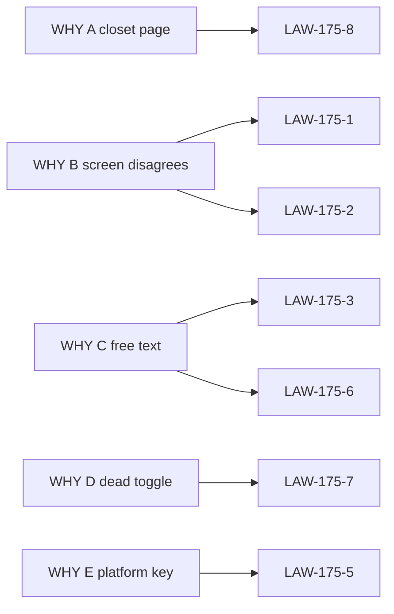

# 14 — Cross-reference

Parent: [README](README.md) · Prev: [13-e2e-test-matrix](13-e2e-test-matrix.md) · Next: [15-roles](15-roles.md)

## WHY to law

| WHY | Laws |
|-----|------|
| A closet page | LAW-175-8, LAW-175-13 |
| B screen disagrees | LAW-175-1, LAW-175-2, LAW-175-10, LAW-175-12 |
| C free text | LAW-175-3, LAW-175-4, LAW-175-6 |
| D dead toggle | LAW-175-7, LAW-175-16 |
| E platform key | LAW-175-5, LAW-175-11 |

## Law to finding, case, wave, test, lens

| Law | Finding | ECs | Wave | Primary test | Lens |
|-----|---------|-----|------|--------------|------|
| LAW-175-1 | F-175-02, F-175-03, F-175-04, F-175-05 | 01, 03, 22 | W1 | `usage_lock_beats_workspace_role` | Full stack, AI |
| LAW-175-2 | F-175-02, F-175-17 | 12, 13 | W1 | `usage_priority_swaps_leaf_only` | AI |
| LAW-175-3 | F-175-07, F-175-13, F-175-15, F-175-22 | 06, 08, 11, 53 | W2, W4, W5 | `e2e_spec175_capability_mismatch` | AI, Front |
| LAW-175-4 | F-175-04, F-175-16 | 03, 22, 28, 54 | W1, W5 | `e2e_spec175_request_beats_connection` | Full stack |
| LAW-175-5 | F-175-06 | 04, 05, 32 | W1, W2 | `e2e_spec175_fail_closed_credential` | SaaS, Full stack |
| LAW-175-6 | F-175-14, F-175-18 | 16, 19, 30 | W2, W4 | `e2e_spec175_empty_policy` | SaaS, Database |
| LAW-175-7 | F-175-08, F-175-12, F-175-19 | 09, 17, 23 | W4, W5 | `e2e_spec175_rerank_model_rejected` | Product, UX |
| LAW-175-8 | F-175-01, F-175-09, F-175-10, F-175-24 | 24, 29, 33, 34 | W3, W4 | `spec175-deeplink-settings` | UX, SaaS |
| LAW-175-9 | F-175-14 | 02, 19 | W1, W2 | `e2e_spec175_empty_policy` | Product, SaaS |
| LAW-175-10 | F-175-03, F-175-05 | 01, 02, 20, 21 | W1 | `usage_extract_pin_without_metadata` | AI |
| LAW-175-11 | F-175-20 | 15, 25 | W2 | `e2e_spec175_connection_other_tenant` | Database, SaaS |
| LAW-175-12 | F-175-17 | 01 | W2 | `GET /config/effective` usages | Full stack |
| LAW-175-13 | F-175-18, F-175-25 | 16, 31, 34, 36, 38 | W2, W3 | `e2e_spec175_workspace_admin_cannot_write_ceiling` | SaaS |
| LAW-175-14 | F-175-20 | 18, 26, 27 | W1, W5 | `answer_cache_key_includes_model` | AI, Database |
| LAW-175-15 | all | 01–54 | W6 | [13-e2e-test-matrix](13-e2e-test-matrix.md) | Full stack |
| LAW-175-16 | F-175-11, F-175-21, F-175-23 | 28, 35 | W3, W5 | `spec175-query-inherit` | Front, UX |
| LAW-175-17 | F-175-25, F-175-26 | 36–52 | W2, W3 | `spec175-platform-badge-not-super` | SaaS, UX |

## Finding to surface

| Finding | Surface |
|---------|---------|
| F-175-01 | [02-surfaces](02-surfaces.md) `/settings` scroll |
| F-175-02 | [05-resolution-law](05-resolution-law.md) |
| F-175-03 | `llm_roles.rs` `resolve_extract_role_llm` |
| F-175-04 | `providers/resolver.rs` `resolve_llm_provider_for_workspace` |
| F-175-05 | `vlm_provider_resolver.rs` `resolve_workspace_vlm_config` |
| F-175-06 | `query_execution.rs` `execute_sota_query_with_auth_fallback` |
| F-175-07 | `model-role-matrix-card.tsx` |
| F-175-08 | `settings/page.tsx` rerank and gleaning |
| F-175-09 | two provider status cards |
| F-175-10 | `app/w/[slug]/settings/page.tsx` |
| F-175-11 | `workspace/page.tsx` `isEditing={false}` |
| F-175-12 | header vs `useSettingsStore` |
| F-175-13 | `openapi/schema.d.ts` `llm_roles` |
| F-175-14 | no policy table before migration 221 |
| F-175-15 | `LlmRole::all` |
| F-175-16 | `use-settings-store.ts` provider default |
| F-175-17 | compiled defaults inside `env_role_llm` |
| F-175-18 | client gates on `/settings` |
| F-175-19 | `query_types.rs` `rerank_model` |
| F-175-20 | embedding connection vs `resolve_embedding_choice` |
| F-175-21 | PDF and vision edited in two pages |
| F-175-22 | `gpt-4o-mini` examples |
| F-175-23 | `GraphSettingsPanel` title |
| F-175-24 | `IdentityProvidersCard` only on members SSO |
| F-175-25 | `get_user_role` tenant-wide filter · [15-roles](15-roles.md) |
| F-175-26 | `global_resource` `/api/v1/settings/` · [15-roles](15-roles.md) |

## Market pattern to law

| Pattern | Source | Law |
|---------|--------|-----|
| Scope is the owner | Vercel, GitHub | LAW-175-8 |
| Search before hierarchy | Linear | LAW-175-8, EC-175-33 |
| Setting sits on the object | Notion | LAW-175-16 |
| Show only models you enabled | K2View Fabric Studio | LAW-175-6 |
| Controls follow capabilities | BYOK | LAW-175-3 |
| A setting must earn its place | Brainy Papers, rule 6 | LAW-175-7 |
| Org role is not the project role | GitHub, Slack Grid, Vercel | LAW-175-17, [15-roles](15-roles.md) |

## Surface to wire

The inventory in [02-surfaces](02-surfaces.md) maps onto wire ids
[W-01](09-ux-ui-spec.md#shell) through [W-34](09-ux-ui-spec.md#w-34-platform-admin)
in the coverage table of [09-ux-ui-spec](09-ux-ui-spec.md). A surface with
no wire id is either removed (rerank, gleaning, free-text model ids, the
second provider card) or left to [SPEC-174](../174-document-security/09-ux-ui-spec.md)
(the inside of the labels card).
