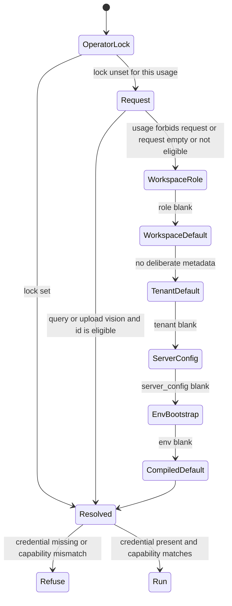

# SPEC-175 — Perfect settings

> **Status:** Specified (W0). No product code in this pack.
> **Product pin:** EdgeQuake v0.38.0. Migration file head is
> [220_spec174_document_clearance.sql](../../edgequake/migrations/220_spec174_document_clearance.sql).
> This pack reserves migration **221**.
> **Scope:** Settings information architecture, and one resolver for which
> provider and model runs for each usage. Tenant and workspace policy decide
> which healthy models a person may see. Secrets stay on connections.
> **Inherits:** [SPEC-123](../123-env-config-priority/) model ladder ·
> [SPEC-109](../109-configurable-reasoning-effort/) reasoning effort ·
> [SPEC-043](../043-update-edgequake-llm/000-index.md) catalog and discovery ·
> [SPEC-163](../163-onboarding-provider-config/) connections ·
> [SPEC-026](../026-egdequake-vs-lightrag/) `llm_roles` ·
> [SPEC-160](../160-tev1/) decision model ·
> [SPEC-168](../168-perfect-ui/) settings chips ·
> [SPEC-101](../101-wizard-mode-tenant-workspace/) wizard ·
> [SPEC-124](../124-langfuse-support/) observability ·
> [SPEC-158](../158-entreprise-grade-authentication/) SSO ·
> [SPEC-131](../131-env-config-temp-openai-support/) transport flags stay out of this UI ·
> [SPEC-001](../001-benchmark/) Acc keeps an explicit operator lock.
> **Peers:** [SPEC-174](../174-document-security/) document labels stay a
> workspace access surface. This pack moves that card. It does not change
> the clearance algebra.

## Start here

1. [00-why.md](00-why.md) — Five WHYs
2. [01-first-principles.md](01-first-principles.md) — LAW-175-1…17 + DRY/SOLID
3. [02-surfaces.md](02-surfaces.md) — Inventory of every settings surface
4. [03-product-spec.md](03-product-spec.md) — Personas, stories, acceptance
5. [04-findings.md](04-findings.md) — F-175-* with file and symbol
6. [05-resolution-law.md](05-resolution-law.md) — The visible ladder
7. [06-catalog.md](06-catalog.md) — Capabilities, probes, ceiling, narrowing
8. [07-data-and-db-contract.md](07-data-and-db-contract.md) — Migration 221
9. [08-api-contract.md](08-api-contract.md) — Effective config, 422s, OpenAPI
10. [09-ux-ui-spec.md](09-ux-ui-spec.md) — ASCII layouts and wireframes
11. [10-frontend-architecture.md](10-frontend-architecture.md) — One shell, one picker
12. [11-edge-cases.md](11-edge-cases.md) — EC-175 register
13. [12-implementation-plan.md](12-implementation-plan.md) — Waves W0–W6
14. [13-e2e-test-matrix.md](13-e2e-test-matrix.md) — One gate per EC
15. [14-cross-ref.md](14-cross-ref.md) — Law, finding, EC, wave, test, lens
16. [15-roles.md](15-roles.md) — Super Admin, Workspace Admin, Platform Admin
17. Lenses → [`lenses/`](lenses/)
    - [Product Owner](lenses/LENS-product-owner.md)
    - [Full Stack](lenses/LENS-full-stack.md)
    - [Database](lenses/LENS-database.md)
    - [UX / UI](lenses/LENS-ux-ui.md)
    - [Front](lenses/LENS-front.md)
    - [SaaS](lenses/LENS-saas.md)
    - [AI Engineer](lenses/LENS-ai-engineer.md)

## Locked decisions (Wave 0)

1. **One visible ladder.** Operator lock, then request (only where that
   usage allows it), then workspace role, workspace default, tenant
   default, server `llm_defaults`, env bootstrap, compiled default.
   [LAW-175-2](01-first-principles.md). The screen's effective model is
   the model that runs ([LAW-123-1](../123-env-config-priority/), restated as
   [LAW-175-1](01-first-principles.md)).
2. **Existing pins become locks.** `EDGEQUAKE_EXTRACT_LLM_*`,
   `EDGEQUAKE_KEYWORD_LLM_*`, and `EDGEQUAKE_VISION_*_MANUSCRIPT` win and
   are labeled `operator_lock`. `EDGEQUAKE_LLM_PROVIDER` stays a bootstrap
   leaf. SPEC-001 Acc does not need a new flag.
3. **Fail closed.** A missing credential does not fall through to
   `ProviderFactory::from_env`. [LAW-175-5](01-first-principles.md).
4. **Usage is a type.** `extract | query | summary | vlm | keyword` plus
   `embedding | decision | rerank`. A model is offered only when its
   capability matches. [LAW-175-3](01-first-principles.md).
5. **Request is narrow.** Only query and per-document vision upload may
   override, and only inside the eligible set. [LAW-175-4](01-first-principles.md).
6. **Catalog is policy. Selection is assignment.** Instance owns
   connections. Tenant owns the ceiling. Workspace may narrow and assigns
   each usage. An empty policy table means every healthy, capability-matched
   model, so existing tenants do not go dark. [LAW-175-6](01-first-principles.md)
   [LAW-175-9](01-first-principles.md).
7. **A control writes the reader or it leaves.** Personal rerank and
   gleaning do not reach the pipeline. They leave the personal page.
   [LAW-175-7](01-first-principles.md).
8. **Scope is the navigation.** You, Workspace, Organization, Deployment.
   Search inside the shell. Contextual sheets stay next to the work and
   call the same resolver. [LAW-175-8](01-first-principles.md).
9. **No auto-reprocess.** Changing the extract model affects new work.
   Rebuild stays an explicit action. Caches do not cross models.
   [LAW-175-14](01-first-principles.md).
10. **Every EC-175 has a named test.** [LAW-175-15](01-first-principles.md).
11. **Three admins, one membership table.** Super Admin is a tenant-wide
    owner or admin. Workspace Admin is an owner or admin of one workspace.
    Platform Admin is `Role::Admin` and is not called Super Admin.
    [LAW-175-17](01-first-principles.md) · [15-roles](15-roles.md).

## Job in one screen

```text
+--------------------------------------------------------------------+
| Member picker, upload form, pipeline                               |
|                 |                                                  |
|                 v                                                  |
| resolve_usage(usage, ctx)                                          |
| edgequake-core, no HTTP, no SQL                                    |
+--------------------------------------------------------------------+
| ResolvedUsage                                                      |
| provider, model, connection, effort, source                        |
+--------------------------------+-----------------------------------+
| Run this pair, or 422 / 503    | GET /config/effective             |
+--------------------------------+-----------------------------------+
```

Who may configure what:

```text
  +----------------+------------------+---------------------------+
  | Owner          | Stores           | Person who edits          |
  +----------------+------------------+---------------------------+
  | You            | edgequake-       | the signed-in user        |
  |                | settings         |                           |
  | Workspace      | llm_roles,       | workspace owner or admin  |
  |                | metadata keys    |                           |
  | Organization   | tenant default_* | tenant owner or admin     |
  |                | + policy ceiling |                           |
  | Deployment     | connections,     | instance admin            |
  |                | server_config    |                           |
  +----------------+------------------+---------------------------+
```

Resolution (same function for run and for display):


