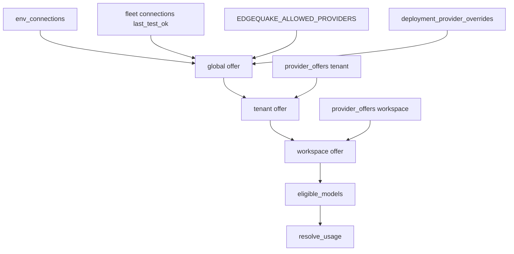

# 05 — Cascade law

Parent: [README](README.md) · Prev: [04-findings](04-findings.md) ·
Next: [06-screens](06-screens.md)

This file is the contract for the offer. [LAW-177-1](01-first-principles.md)
and [LAW-177-4](01-first-principles.md) point here. `eligible_models`
consumes the result. It does not re-derive it.

## Identity

A provider slug is the lowercase string already used as
`CatalogEntry.provider` and as `provider_connections.slug` for fleet and
env rows. Comparison is case-insensitive. Storage is lowercase.

A custom connection's models use that connection's slug as their provider
id. They do not inherit the `openai` cards because the shape is
`openai_chat` ([F-177-11](04-findings.md)).

## Global offer

```text
  candidates
     = slugs from env_connections
     + slugs from provider_connections where tenant_id is null
  drop a slug that EDGEQUAKE_ALLOWED_PROVIDERS excludes
  drop a slug whose deployment_provider_overrides.withdrawn is true
  drop a fleet slug whose last_test_ok is not true
  what remains is the global offer
```

Env slugs do not need `last_test_ok`. Their presence in `env_connections`
means the process key or host is set. A failed live health check follows
SPEC-175: the admin list shows the status, and member pickers already
hide `probe = Some(false)`. Withdrawal is the only way an env slug leaves
the global offer while the variable stays set.

A fleet row with `last_test_ok` null or false is on the admin list as
"Not offered." It is not in the global offer.

There is no 24-hour clock in the current probe column. This pack does not
add one. Staleness stays a SPEC-175 follow-up. The gate that exists is
`last_test_ok`.

## Tenant offer

```text
  if tenants.provider_offer_constrained is false:
       tenant offer = global offer
       mode = unconstrained
       rows are ignored
  else:
       tenant offer = global offer
                     intersect enabled rows
                     with workspace_id null
       mode = constrained
  a row whose slug is no longer in the global offer is ignored
```

Rows store enabled slugs only. The boolean is the mode, because an empty
row set must be able to mean "this tenant offers nothing"
([07-data-and-db-contract](07-data-and-db-contract.md)). In constrained
mode a slug with no row is absent. The writer sends the full enabled list
and the mode. It does not send a sparse patch.

## Workspace offer

```text
  parent = tenant offer
  if workspaces.provider_offer_constrained is false:
       workspace offer = parent
       mode = unconstrained
  else:
       workspace offer = parent
                        intersect enabled rows
                        for this workspace_id
       mode = constrained
```

A workspace row cannot add a slug the tenant offer omitted.
[EC-177-20](11-edge-cases.md).

## Where it sits on the SPEC-175 ladder

`resolve_usage` order does not change. The offer is a filter on the
catalog before the ladder fills a blank layer, and a check on the pair
the ladder already chose.

```text
  1 operator_lock
       if the credential exists, the pair runs
       the offer does not apply to this step
  2 request (query, or vlm on that upload)
       the pair must be in the workspace offer
       and in eligible_models
       else broken_reason = not_eligible
       no fallthrough
  3 workspace_role
  4 workspace_default
  5 tenant_default
  6 server_config
  7 env_bootstrap
  8 compiled_default
       steps 3-8 name a pair
       the pair's provider must be in the workspace offer
       else broken_reason = not_eligible
       no fallthrough to a lower layer
       no fallthrough to ProviderFactory::from_env
```

Step 1 is [LAW-177-8](01-first-principles.md). Steps 2–8 are
[LAW-177-5](01-first-principles.md). A blank layer is still skipped.
A layer that names an illegal pair is a refusal, not a blank.

## Model ticks inside the offer

After the slug filter, [LAW-175-6](../175-perfect-settings/01-first-principles.md)
is unchanged:

```text
  candidates = catalog entries whose provider is in the workspace offer
  capability, registered, probe
  tenant ceiling for the usage, if that usage has rows
  workspace narrowing for the usage, if that usage has rows
  = eligible_models(usage, workspace)
```

Disabling the last model of a provider does not remove the provider from
the offer. The usage then has an empty eligible set and the save is
refused when it would empty a usage the editor just wrote
(`usages_left_empty`, already in `eligibility.rs`). A provider with only
embedding models does not have to offer a chat model.

Global model ticks, when the deployment providers page writes them, are
ceiling rows with no tenant: they are not added to `model_catalog_policy`,
because that table is tenant-scoped. The deployment page enables or
disables models by writing the discovered ids onto the connection's model
list. The storage for that list is specified in
[07-data-and-db-contract](07-data-and-db-contract.md) as
`connection_models`. Tenant and workspace model ticks stay
`model_catalog_policy`.

## Modes the API returns

| Field | Values |
|-------|--------|
| `offer_mode` | `unconstrained` or `constrained` |
| `parent_count` | how many slugs the parent offered |
| `enabled_count` | how many of those this scope enabled, or `parent_count` when unconstrained |

The UI uses `offer_mode` for the confirm sentence in
[03-product-spec](03-product-spec.md). It does not infer the mode by
counting checkboxes alone.

## Flow



## Legacy tenant connections

A row with `tenant_id` set is outside the global offer. The owning
tenant's read model includes it in `legacy[]` and nowhere else. Existing
`llm_roles` that name that slug keep resolving for that tenant's
workspaces until the follow-up pack. New roles may not select it. Tenant
B's payload omits it. [EC-177-33](11-edge-cases.md).

## What a delete does

```text
  delete fleet connection
        |
        +-- delete secret_ref (SPEC-176)
        +-- delete provider_offers rows for that slug
        +-- delete connection_models for that connection
        +-- leave llm_roles in place
        |
        v
  next resolve_usage
        |
        +-- not_eligible when the role still names the slug
        +-- documents stay as they were
```
