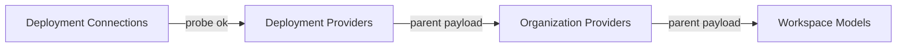

# 06 — Screens

Parent: [README](README.md) · Prev: [05-cascade-law](05-cascade-law.md) ·
Next: [07-data-and-db-contract](07-data-and-db-contract.md)

Wireframes for the target. The current pages are [02-surfaces](02-surfaces.md).
Copy is [09-ux-ui-spec](09-ux-ui-spec.md). One component family is
[10-frontend-architecture](10-frontend-architecture.md).

## Where the screens sit

```text
Deployment
  +-- Connections     add, test, remove, key
  +-- Providers       offered or withdrawn, then models
  +-- Fleet           unchanged
  +-- Observability   unchanged

Organization
  +-- People          members only, after this pack
  +-- Providers       subset of the global offer, then models
  +-- Secrets         backend only, unchanged

Workspace
  +-- Models          subset of the tenant offer, then usages
```



## Deployment → Connections

Extends [`connections-card.tsx`](../../edgequake_webui/src/components/settings/connections-card.tsx).
No second form.

```text
+------------------------------------------------------------------+
| Connections                                                      |
| Add an OpenAI-compatible or Anthropic-compatible provider.       |
+------------------------------------------------------------------+
| Display name    [ Acme proxy                               ]     |
| API             [ OpenAI-compatible                     v ]      |
| Base URL        [ https://acme.example/v1               ]        |
| API key         [ ********                                ]      |
|                                   [ Test ]  [ Save ]             |
+------------------------------------------------------------------+
| Slug          Shape           Probe     Offer       Key          |
| openai        OpenAI-compat   From env  Offered     server       |
|               [ Withdraw ]                                       |
| acme          OpenAI-compat   Passed    Offered     ..a1b2       |
|               [ Remove ]                                         |
| broken-proxy  Anthropic       Failed    Not offered ..c3d4       |
|               [ Test ] [ Remove ]                                |
+------------------------------------------------------------------+
```

The shape select has three options: OpenAI-compatible, Anthropic-compatible,
Ollama. Ollama's key field is optional. The other two disable Save until
the key has a value on create.

Env rows have Withdraw, not Remove. Fleet rows have Remove. A failed
probe shows Not offered and stays on this list.

The key input clears after a successful save. The list shows the
fingerprint suffix, never the key.

## Deployment → Providers

```text
+------------------------------------------------------------------+
| Providers                                                        |
| These are the providers organizations can turn on.               |
+------------------------------------------------------------------+
| [ openai          Offered ]   [ acme            Offered ]        |
| [ broken-proxy    Not offered, test failed ]                     |
+------------------------------------------------------------------+
| openai                                                           |
| Hidden from organizations: [ ]                                   |
|                                                                  |
| Model             Extract   Query   Embed                        |
| gpt-5-nano        [x]       [x]     [ ]                          |
| text-embed-small  [ ]       [ ]     [x]                          |
|                                   [ Save models ]                |
+------------------------------------------------------------------+
```

Selecting a provider shows its models. Env providers do not have
"Save models"; their models come from the catalog cards. Fleet providers
save `connection_models`. A provider that is Not offered has its model
table disabled and the probe sentence from [03-product-spec](03-product-spec.md).

Withdraw on this page and Withdraw on Connections call the same PUT.

## Organization → Providers

The ceiling card leaves People. This page is the tenant editor.

```text
+------------------------------------------------------------------+
| Providers                                                        |
| People in this organization can use every provider this          |
| deployment offers.                                               |
+------------------------------------------------------------------+
| [x] openai          12 models                                    |
| [ ] acme             2 models                                    |
|                                                                  |
| openai / models                                                  |
| Model             Extract   Query   Vision   Embed               |
| gpt-5-nano        [x]       [x]     [ ]      [ ]                 |
|                                   [ Save ]                       |
+------------------------------------------------------------------+
| This organization has a key saved earlier.                       |
| Legacy: acme-old. New keys are added on Deployment.              |
+------------------------------------------------------------------+
```

`acme` is visible because it is in the global offer. A provider that is
not in the global offer has no row. The legacy block is present only when
`legacy[]` is non-empty. It has no enable checkbox.

Save on an unconstrained tenant opens the confirm sentence, then sends
`offer_mode: constrained`. A second control, "Use every provider this
deployment offers", sends `unconstrained` and is hidden until the tenant
is constrained.

Model checkboxes for a provider whose provider checkbox is off are
disabled. They are not submitted as enabled.

## Workspace → Models

The role editor stays. The provider list is the first card.

```text
+------------------------------------------------------------------+
| Models                                                           |
| This workspace can use every provider the organization offers.   |
+------------------------------------------------------------------+
| Providers                                                        |
| [x] openai                                                       |
| This provider is not offered to you.                             |
+------------------------------------------------------------------+
| Jobs                                                             |
| Extract   openai / gpt-5-nano        This workspace   [Change]   |
| Query     Inherit                    Organization default        |
| Embed     openai / text-embed-small  This workspace   [Change]   |
+------------------------------------------------------------------+
```

The error line is the `422` after a stale save. A provider the tenant
does not offer has no checkbox. The Change menu lists models in the
workspace offer that match the usage. Inherit stays first.

## Member chip

```text
+----------------------------------+
| Model                      [v]   |
| Inherit                          |
| openai / gpt-5-nano              |
| openai / gpt-5-mini              |
+----------------------------------+
```

No row for a provider outside the workspace offer. A locked usage does
not open the menu. The lock sentence replaces the menu.

## Navigation for a workspace admin

```text
Settings
  You
  Workspace
    Models
    Ingestion
    Access
```

Organization and Deployment are absent. Search for "provider" returns
Workspace → Models, not Organization → Providers.

## States on one provider row

```text
Offered -------- withdraw -------> Withdrawn
   ^                                  |
   |                                  |
   +------------- restore ------------+

Unchecked probe --> Not offered
Failed probe -----> Not offered
Passed probe -----> Offered, unless withdrawn
```

Restore clears `withdrawn`. It does not recreate a deleted connection.
