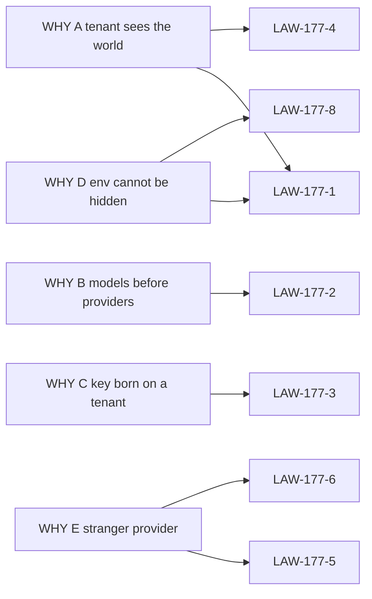

# 14 — Cross-reference

Parent: [README](README.md) · Prev: [13-e2e-test-matrix](13-e2e-test-matrix.md)

## WHY to law

| WHY | Laws |
|-----|------|
| A The tenant sees the world | LAW-177-1, LAW-177-4 |
| B Models before providers | LAW-177-2, LAW-177-7 |
| C A key can be born on a tenant | LAW-177-3, LAW-177-9 |
| D An env provider cannot be hidden | LAW-177-1, LAW-177-8 |
| E The run can name a stranger | LAW-177-5, LAW-177-6 |

## Law to finding, case, wave, test, lens

| Law | Finding | ECs | Wave | Primary test | Lens |
|-----|---------|-----|------|--------------|------|
| LAW-177-1 | F-177-01, F-177-06, F-177-07, F-177-11 | 01, 02, 11, 18, 20, 44, 46 | W1, W2 | `empty_global_offer_drops_catalog_cards` | Product, SaaS |
| LAW-177-2 | F-177-03 | 09, 17, 28, 35 | W1, W4 | `withdraw_drops_embed_and_chat` | UX, AI |
| LAW-177-3 | F-177-04, F-177-05, F-177-10 | 03, 08, 12, 23, 24, 25, 33, 36, 37, 47 | W2, W4, W5 | `tenant_header_on_create_is_422` | SaaS, Full stack |
| LAW-177-4 | F-177-02 | 04, 05, 16, 22, 31, 34 | W1, W2, W4 | `constrained_child_hides_new_parent_slug` | Product, Database |
| LAW-177-5 | F-177-09 | 06, 07, 13, 32, 42 | W2, W3 | `delete_connection_removes_offers_and_refuses_role` | Full stack, AI |
| LAW-177-6 | F-177-09 | 13, 21, 40, 41 | W1, W3, W4 | `catalog_omits_unoffered_provider` | Full stack, Front |
| LAW-177-7 | F-177-08 | 14, 29, 30, 38 | W4 | `e2e/spec177/nav.spec.ts` | UX, Front |
| LAW-177-8 | F-177-06 | 10, 15, 27, 39 | W2, W3 | `lock_ignores_withdrawn_grant` | AI, SaaS |
| LAW-177-9 | F-177-11, F-177-12 | 19, 26, 35, 43, 45 | W2, W4 | `offer_tables_have_no_secret_column` | Database |
| LAW-177-10 | all | 01–47 | W1–W5 | [13-e2e-test-matrix](13-e2e-test-matrix.md) | Full stack |

## Finding to surface

| Finding | Surface |
|---------|---------|
| F-177-01 | `get_tenant_model_catalog` → `load_catalog` |
| F-177-02 | `within_ceiling` and the ceiling card copy |
| F-177-03 | `TenantModelCeilingCard` table |
| F-177-04 | `create_connection` → `scoped_tenant` |
| F-177-05 | `connection_list_sql` |
| F-177-06 | `env_connections` |
| F-177-07 | `active_provider_names` |
| F-177-08 | `people-section.tsx` and `SECTION_COMPONENTS` |
| F-177-09 | `eligible_models` and `resolve_usage` |
| F-177-10 | `upsert` does not require `last_test_ok` |
| F-177-11 | `from_llm` provider string versus connection slug |
| F-177-12 | `SecretService::put` and Organization → Secrets |

## SPEC-175 laws this pack touches

| SPEC-175 | What SPEC-177 does |
|----------|--------------------|
| LAW-175-2 | Ladder order unchanged. Offer filters the catalog and refuses an illegal pair. Lock stays step 1. |
| LAW-175-5 | Restated for a missing parent. No new fallback. |
| LAW-175-6 | Model ticks stay on `model_catalog_policy`. |
| LAW-175-8 | Scopes unchanged. Two sections added. |
| LAW-175-9 | Universe shrinks to the parent offer. Unconstrained mode stays, encoded as `provider_offer_constrained = false`. |
| LAW-175-10 | Lock still disables the picker. |
| LAW-175-11 | Fleet connection remains the shared credential. New tenant-scoped creates stop. |
| LAW-175-13 | Same three admins. No new role. |

## Lens to the pages they own

| Lens | Read first |
|------|------------|
| [Product Owner](lenses/LENS-product-owner.md) | 03, LAW-177-4, LAW-177-8 |
| [Full Stack](lenses/LENS-full-stack.md) | 08, 10, 12 |
| [Database](lenses/LENS-database.md) | 07, LAW-177-9 |
| [UX / UI](lenses/LENS-ux-ui.md) | 06, 09 |
| [Front](lenses/LENS-front.md) | 10, LAW-177-6 |
| [AI Engineer](lenses/LENS-ai-engineer.md) | 05, LAW-177-2, LAW-177-8 |
| [SaaS](lenses/LENS-saas.md) | LAW-177-3, LAW-177-5, EC-177-08 |
