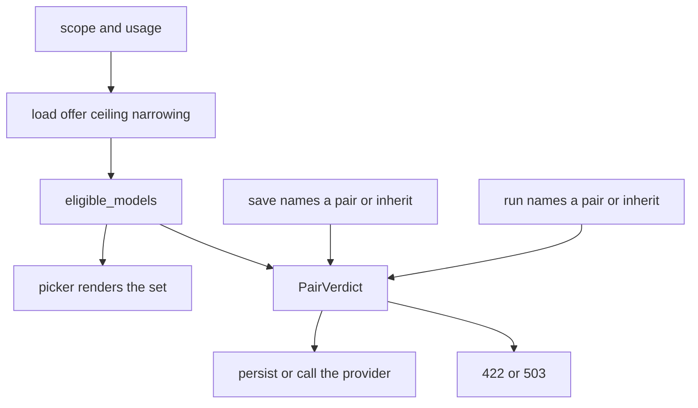

# 05 — Choice law

Parent: [README](README.md) · Prev: [04-findings](04-findings.md) ·
Next: [06-screens](06-screens.md)

This file is the contract for a choice. [LAW-178-2](01-first-principles.md)
and [LAW-178-3](01-first-principles.md) point here. `eligible_models`
already implements the membership test. Callers stop passing a wider
catalog.

## Arguments

```text
  eligible(scope, usage) =
       eligible_models(
         usage,
         catalog,
         ceiling(scope),
         narrowing(scope),
         Some(offer(scope)),
       )
```

The function signature in
[`eligibility.rs`](../../edgequake/crates/edgequake-core/src/model_policy/eligibility.rs)
does not grow a scope enum. The API loader picks the three collections.
Core stays free of SQL. [DIP](01-first-principles.md).

| Scope | `offer(scope)` | `ceiling(scope)` | `narrowing(scope)` |
|-------|----------------|------------------|--------------------|
| deployment | global offer | empty | empty |
| tenant | tenant offer | rows with `workspace_id` null | empty |
| workspace | workspace offer | rows with `workspace_id` null | rows for this workspace |

Global offer, tenant offer, and workspace offer are
[05-cascade-law](../177-provider-cascade/05-cascade-law.md). This file
does not restate them.

`offered = None` remains a test seam. Production choice paths pass
`Some`. The comment that tells readers to pass `None` is
[F-178-18](04-findings.md).

## What a member may see

Inside the offer, membership is unchanged:

```text
  registered
  supports(usage)
  probe is not Some(false)
  within the ceiling, when that usage has ceiling rows
  not removed by a workspace narrowing row
```

Failed probes stay on the admin catalog
(`GET /tenants/{id}/model-catalog`) and leave the choice list.
[EC-178-19](11-edge-cases.md).

`supports` stays [`ModelFacts::supports`](../../edgequake/crates/edgequake-core/src/model_policy/mod.rs):
embedding requires the embedding flag, vlm requires chat and vision,
extract / query / summary / keyword / decision require chat, rerank
matches nothing.

## Family intersection

A workspace family key and a tenant `default_llm_*` pair are one pair
for four usages. The picker for that key lists:

```text
  eligible(scope, extract)
  intersect eligible(scope, query)
  intersect eligible(scope, summary)
  intersect eligible(scope, keyword)
```

A save of that key uses the same intersection. A model the ceiling
allows for query and removes for extract is absent from the family
picker. It may still appear on the extract role row if the ceiling
allows it there, and on the query role row if the ceiling allows it
there. Role rows are per usage. [EC-178-29](11-edge-cases.md).

Vision, embedding, and decision are single-usage lists. They are not
part of the intersection.

## Empty and broken

```text
  body names neither field     inherit     store nothing, run the ladder
  body names one field         422 model_pair_incomplete
  body names a pair in the set store it, run it when it wins the ladder
  body names a pair outside    422 model_not_eligible or capability_mismatch
  stored pair later outside    leave the row, effective.eligible = false
                               run returns 422, no other model is substituted
```

Operator lock: the picker is disabled and shows the lock pair. A request
that still names a pair gets `422 usage_locked`. An empty request runs
the lock. [EC-178-10](11-edge-cases.md) · [EC-178-37](11-edge-cases.md).

## Where the request sits

```text
  1 operator_lock
       request pair present -> 422 usage_locked
       request empty        -> run the lock
  2 request (query, or vlm on that upload)
       both fields, in eligible(workspace, usage) -> run this pair
       both fields, not in the set                -> 422, stop
       one field                                  -> 422 model_pair_incomplete
       connection_id on the role is not consulted
  3 workspace_role, including connection_id
  4 workspace_default
  5 tenant_default
  6 server_config
  7 env_bootstrap
  8 compiled_default
       steps 3-8 name a pair
       the pair must be in eligible(workspace, usage)
       else broken_reason = not_eligible
       the handler does not call the process provider
```

Step 2 before step 3 is the correction of [F-178-11](04-findings.md).
[LAW-178-9](01-first-principles.md).

## List, save, run



The picker does not draw a model `elig` omitted. The save and the run
call `verdict` anyway, because the picker is a convenience
([LAW-178-7](01-first-principles.md)).

## Embedding card

An embedding choice carries `embedding_dimension` from the eligible
card ([08-api-contract](08-api-contract.md)). The writer stores that
integer with the model. A disagreeing integer in the body is
`422 embedding_dimension_mismatch`. Missing dimension on a card that
declares none is `422 model_not_eligible` for the embedding usage.
The historical guess of 1536 in
[`detect_dimension_from_model`](../../edgequake/crates/edgequake-core/src/types/multitenancy/workspace.rs)
is not used on this write path. [EC-178-14](11-edge-cases.md).

Existing rows that already store 1536 for an unknown model are left in
place until an editor saves a card. The effective embedding row reports
`broken_reason = not_eligible` when the id is outside the set.

## Images

A turn with images uses usage `vlm`.

```text
  request pair present
       pair in eligible(workspace, vlm) -> run it
       pair supports chat and not vision -> 422 capability_mismatch
       pair absent from the vlm set       -> 422 model_not_eligible
  request pair absent
       resolve_usage(vlm)
       eligible -> run that pair
       not eligible -> 422, no process vision client
```

[`completion.rs`](../../edgequake/crates/edgequake-api/src/handlers/chat/completion.rs)
lines 289–298 stop substituting `state.query.vision_llm_provider`.
[F-178-16](04-findings.md) · [EC-178-24](11-edge-cases.md).

## What this law does not change

- Provider offer algebra and `provider_offer_constrained`.
- `usages_left_empty` on a policy write. A save that would empty a usage
  the editor just wrote is still refused. [EC-178-26](11-edge-cases.md).
- Widening: a workspace row cannot add a pair the ceiling omitted.
  [EC-178-35](11-edge-cases.md).
- Rebuild of embeddings. A choice save does not enqueue it.
  [EC-178-38](11-edge-cases.md).
- `rerank` and the decision backend kind. Both stay env-level.
- Discovery-only models. They stay unregistered. [EC-178-07](11-edge-cases.md).
