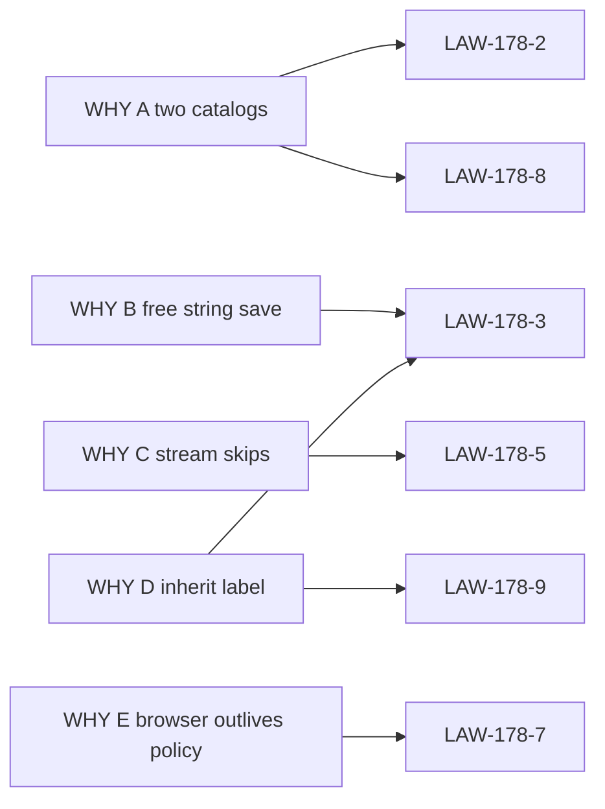

# 14 — Cross-reference

Parent: [README](README.md) · Prev: [13-e2e-test-matrix](13-e2e-test-matrix.md)

## WHY to law

| WHY | Laws |
|-----|------|
| A Two catalogs | LAW-178-1, LAW-178-2, LAW-178-8 |
| B Free-string save | LAW-178-3, LAW-178-4 |
| C Stream skips the check | LAW-178-5, LAW-178-6 |
| D Inherit shows the inventory | LAW-178-3, LAW-178-9 |
| E Browser outlives the policy | LAW-178-7 |

## Law to finding, case, wave, test, lens

| Law | Finding | ECs | Wave | Primary test | Lens |
|-----|---------|-----|------|--------------|------|
| LAW-178-1 | F-178-01 | 20, 21, 26 | W1, W3 | `legacy_tenant_connection_absent_from_eligible` | Product, Database |
| LAW-178-2 | F-178-01, F-178-02, F-178-18 | 09, 15, 16, 32, 39 | W1, W3 | `deployment_eligible_ignores_workspace_narrowing` | Full stack, Front |
| LAW-178-3 | F-178-04, F-178-05, F-178-06, F-178-14 | 03, 06, 18, 23, 29, 34, 36 | W1, W3 | `put_workspace_unknown_pair_is_422` | Product, AI |
| LAW-178-4 | F-178-04 | 41 | W1 | `spec178_adds_no_migration` | Database |
| LAW-178-5 | F-178-07, F-178-09, F-178-10, F-178-12 | 02, 13, 25, 30, 37 | W1 | `stream_and_query_reject_the_same_pair` | Full stack, AI |
| LAW-178-6 | F-178-08, F-178-16 | 12, 14, 24, 36, 38 | W1 | `image_turn_resolves_vlm` | AI, UX |
| LAW-178-7 | F-178-13, F-178-15, F-178-19 | 04, 05, 17, 27, 28, 31 | W1, W2, W3 | `raw_post_query_outside_set_is_422` | Front, Product |
| LAW-178-8 | F-178-03, F-178-17 | 07, 08, 22, 33, 40 | W1, W2, W3 | `unoffered_static_card_absent_from_eligible` | Front, AI |
| LAW-178-9 | F-178-11 | 11 | W1 | `request_pair_beats_query_connection` | AI, Full stack |
| LAW-178-10 | all | 01–41 | W1–W4 | [13-e2e-test-matrix](13-e2e-test-matrix.md) | Full stack |

EC-178-10 (locked chip), EC-178-19 (probe), and EC-178-35 (widening)
sit on inherited SPEC-175 behavior. Their gates are in the matrix.
LAW-178-5 covers the lock refusal (EC-178-37). LAW-178-6 covers the
dimension and the image turn.

## Finding to surface

The table in [04-findings](04-findings.md) is the list. This pack does
not keep a second copy.

## SPEC-175 and SPEC-177 laws this pack cites and does not amend

| Law | How this pack uses it |
|-----|------------------------|
| LAW-175-1, LAW-175-2 | `resolve_usage` order stays. The chip's inherit line reads the result. |
| LAW-175-3 | Capability predicate stays `ModelFacts::supports`. |
| LAW-175-4 | Request layer stays query and upload vlm. This pack stops the connection branch from running first. |
| LAW-175-5 | Fail closed. Choice handlers stop calling the process provider and the auth fallback. |
| LAW-175-6, LAW-175-9 | Empty policy still means every healthy capable model of the offered providers. |
| LAW-175-14 | No auto-rebuild. |
| LAW-177-1 | Absent providers are omitted, not disabled. |
| LAW-177-2 | Provider, then models. Choice does not write a second tick store. |
| LAW-177-4 | Unconstrained means all of the parent offer. |
| LAW-177-5 | No sibling key, no process-key recovery. |
| LAW-177-6 | One `eligible_models`. Scopes are loaders. |
| LAW-177-7 | Shell names stay Deployment, Organization, Workspace. |
| LAW-177-8 | Operator lock bypasses the offer. A request pair while locked is refused, not swapped. |
| LAW-177-9 | One writer per fact. Choice adds none. |

No LAW-175 or LAW-177 sentence is rewritten by this pack.

## Lens to document

| Lens | Reads first |
|------|-------------|
| [Product Owner](lenses/LENS-product-owner.md) | [03-product-spec](03-product-spec.md), LAW-178-1, LAW-178-3 |
| [Full Stack](lenses/LENS-full-stack.md) | [12-implementation-plan](12-implementation-plan.md), [08-api-contract](08-api-contract.md) |
| [Database](lenses/LENS-database.md) | [07-data-and-db-contract](07-data-and-db-contract.md), LAW-178-4 |
| [UX / UI](lenses/LENS-ux-ui.md) | [06-screens](06-screens.md), [09-ux-ui-spec](09-ux-ui-spec.md) |
| [Front](lenses/LENS-front.md) | [10-frontend-architecture](10-frontend-architecture.md), [02-surfaces](02-surfaces.md) |
| [AI Engineer](lenses/LENS-ai-engineer.md) | [05-choice-law](05-choice-law.md), LAW-178-5, LAW-178-6, LAW-178-9 |
