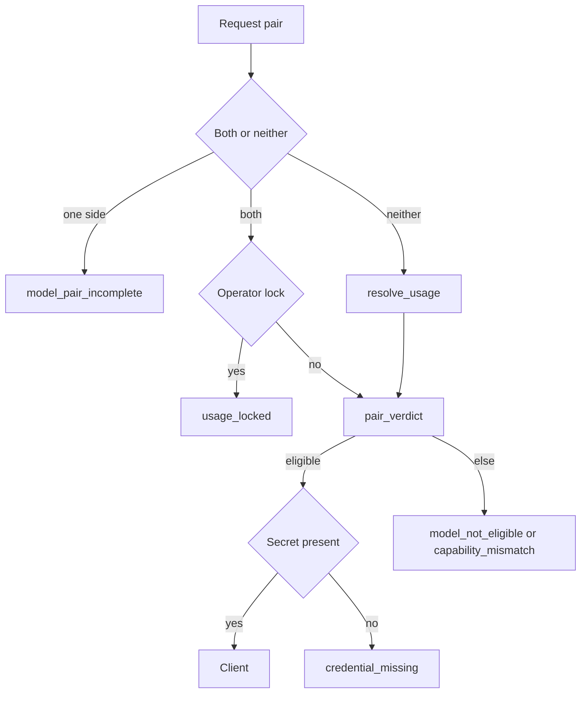

# 05 — Gate law

Parent: [README](README.md) · Prev: [04-findings](04-findings.md) ·
Next: [06-provider-lifecycle](06-provider-lifecycle.md)

## WHY

SPEC-178 judges a pair the caller already resolved. Several callers never
resolve, or resolve and then replace. The gate owns both steps so a caller
cannot forget one of them.

## Algebra

```text
  inputs = offer(scope) + ceiling(tenant) + narrowing(workspace) + catalog
  pair   = request pair, if both names are present
         | else resolve_usage(usage, layers) stored pair
         | else operator lock, if set
         | else error credential_missing / model_not_eligible
  if request is one-sided: model_pair_incomplete
  if request is set and operator_lock_set(usage): usage_locked
  verdict = pair_verdict(usage, pair, inputs)     // existing pure function
  client  = connection(slug) or built-in factory for that slug
  Ok(client) only when verdict is Eligible and the secret decrypts
```



Scope changes the offer, not the function. Deployment passes the global
offer and empty policy rows. Tenant passes the tenant offer and the ceiling.
Workspace passes the workspace offer, the ceiling, and the narrowing. This
is the SPEC-178 scope rule, applied to run as well as to list.

## Fail-closed table

| Caller | On `Err` |
|--------|----------|
| HTTP query, chat, parse, MCP | status from `GateError` |
| Ingest, reprocess, rebuild | document or task `Failed`, `error_code = model_not_eligible` (or the specific code), message includes the settings path |
| Title | uses the client the chat turn already judged. No third lookup |

`offer_unavailable` is 503. Every eligibility miss is 422. `refuse_unoffered`
stops returning 400; the gate replaces that check.

## Caching

One `GateFacts` value is loaded per resolve: offer, ceiling, narrowing,
catalog, connection row. A task that resolves extract and embedding loads
facts once and calls `judge` twice. Writes to offers, policy, or connections
do not need a process cache; the next request reloads. There is no
cross-request cache in this pack, so a replica cannot serve a stale offer.

## What stays outside

`eligible_models` does not learn HTTP. `apply_llm_config_update` stays a
string writer. The handler calls `ensure_workspace_choice` first.
`ProviderFactory::from_env` remains in boot and inside the gate's built-in
arm, which runs only after a verdict of `Eligible`.

## Constructor guard

A test walks the API crate sources. `ProviderFactory::from_env` and
`create_llm_provider` / `create_embedding_provider` may appear in:

- `state/provider_setup.rs` and `state/postgres.rs` / `state/memory.rs` boot
- `services/model_gate.rs`
- `providers/probe.rs` (connection test, admin-only, not a user choice)

Any other file fails the test. [EC-179-19](12-edge-cases.md).
