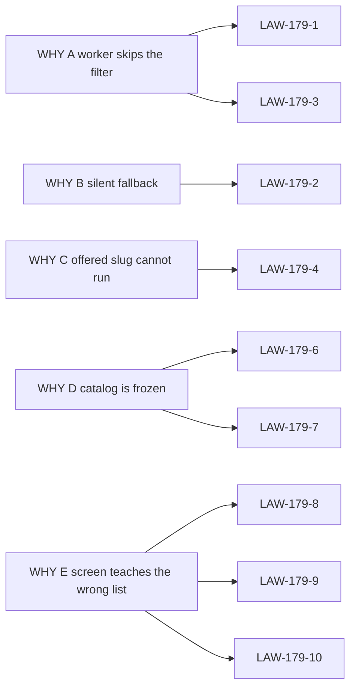

# 15 — Cross-reference

Parent: [README](README.md) · Prev: [14-e2e-test-matrix](14-e2e-test-matrix.md)

## WHY to law

| WHY | Laws |
|-----|------|
| A Worker skips the filter | LAW-179-1, LAW-179-3 |
| B Silent fallback | LAW-179-2 |
| C Offered slug cannot run | LAW-179-4 |
| D Catalog is frozen | LAW-179-6, LAW-179-7 |
| E Screen teaches the wrong list | LAW-179-8, LAW-179-9, LAW-179-10 |

LAW-179-5 is the secret boundary from WHY C's credential half and from
[LAW-177-3](../177-provider-cascade/01-first-principles.md). LAW-179-11 records
the non-goal. LAW-179-12 binds the matrix.

## Law to finding, case, wave, test, lens

| Law | Finding | ECs | Wave | Primary test | Lens |
|-----|---------|-----|------|--------------|------|
| LAW-179-1 | F-179-01, F-179-13 | EC-179-19, EC-179-35 | W1 | `constructor_guard` | Full stack |
| LAW-179-2 | F-179-03, F-179-04, F-179-09 | EC-179-01, EC-179-04, EC-179-12, EC-179-30 | W1 | `ingest_withdrawn_fails` | AI engineer |
| LAW-179-3 | F-179-01, F-179-02 | EC-179-02, EC-179-03, EC-179-20, EC-179-34 | W1 | `rebuild_pair_rejected` | AI engineer |
| LAW-179-4 | F-179-05 | EC-179-05, EC-179-24 | W1 | `fleet_slug_resolves` | Full stack |
| LAW-179-5 | F-179-08 | EC-179-09, EC-179-11, EC-179-18, EC-179-26, EC-179-27 | W2 | `url_userinfo_rejected` | Database |
| LAW-179-6 | F-179-07 | EC-179-07, EC-179-08, EC-179-22, EC-179-32 | W2 | `refresh_keeps_cache_on_error` | AI engineer |
| LAW-179-7 | F-179-06 | EC-179-06 | W2 | `env_connections_native` | Product |
| LAW-179-8 | F-179-10 | EC-179-13, EC-179-14, EC-179-33 | W2 | `withdraw_requires_confirm` | Product |
| LAW-179-9 | F-179-11 | EC-179-15 | W3 | `choice-does-not-search-inventory` | Front |
| LAW-179-10 | F-179-11, F-179-12 | EC-179-16, EC-179-17, EC-179-21, EC-179-28, EC-179-29 | W3 | `offer-error-state` | UX |
| LAW-179-11 | — | — | — | no new backend crate | Database |
| LAW-179-12 | F-179-13 | all | W4, W5 | this table | Product |

## Inherited specs

| Spec | What this pack uses | What it does not reopen |
|------|---------------------|-------------------------|
| [SPEC-175](../175-perfect-settings/README.md) | usages, `model_catalog_policy`, settings shell | the shell's four scopes |
| [SPEC-176](../176-secret-manager/README.md) | `managed_secrets`, Infisical | a third backend |
| [SPEC-177](../177-provider-cascade/README.md) | offer algebra, keys born at Deployment | unconstrained mode |
| [SPEC-178](../178-provider-and-model-choice/README.md) | one eligible set for list, save, and query | a new choice table |

## Lens index

- [Product owner](lenses/LENS-product-owner.md)
- [Full stack](lenses/LENS-full-stack.md)
- [Database](lenses/LENS-database.md)
- [UX / UI](lenses/LENS-ux-ui.md)
- [Front](lenses/LENS-front.md)
- [AI engineer](lenses/LENS-ai-engineer.md)
